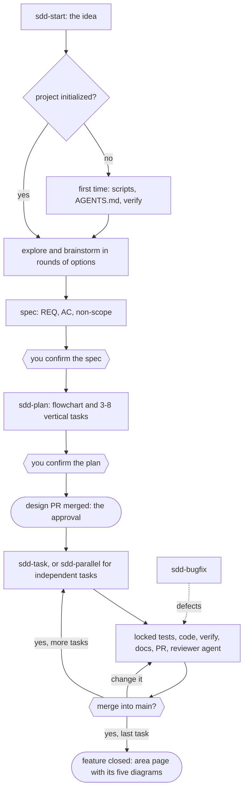

# SDD Playbook (version 0.30.0)

[](CHANGELOG.md)
[](LICENSE)
[](https://github.com/jumping2000/sdd-playbook/actions/workflows/ci.yml)
[](docs/scripts.md)
[](docs/architecture.md)
[](docs/architecture.md)
[](#installation)
[](#installation)
[](#installation)
[](#verification-status)
[](#documentation)
[](https://github.com/jumping2000/sdd-playbook/commits/main)
[](https://github.com/jumping2000/sdd-playbook)

*Versione italiana: [README_IT.md](README_IT.md)*

> **Status: in design.** Tried once on a small real project (a Docker stack, with 0.17.0): it was too heavy for the
> task. 0.30.0 is the simplified method that answers that trial; it has not been tried on a project yet. Formats and
> contracts may still change without compatibility.

**SDD Playbook** (`sdd-playbook`) is a spec-driven development plugin for Claude Code, Codex and GitHub Copilot: you
decide **what** to build and **whether to merge it**, the agent writes spec, plan, tests and code, scripts check that
every step was really done. The method fits in a short [playbook](docs/playbook-ai-software-lifecycle.md).

**Start here:** [Quick guide](docs/quick-guide.md).

## Goal

Make software built with a coding agent **trustworthy without ceremony**:
1. the agent builds **what was decided** in a confirmed spec, and asks instead of guessing;
2. "done" means **verified by a command**, not "looks done";
3. the tests that define "done" are **written from the acceptance criteria and locked before the code**, and an
   independent reviewer agent checks them;
4. the work arrives in **small vertical PRs**, one per task, and the human decides every merge with the results in
   front of them;
5. specs and documentation, diagrams included, **stay aligned** with the code in the same PR;
6. it works the same in **Claude Code, Codex and GitHub Copilot**, on **Windows and Linux**, for **any language**
   (Python, Node, .NET, Go, Java, Rust, C/C++, shell, PowerShell, Docker Compose, Helm, ...), and remains verifiable
   without the plugin. The only tooling requirement is Python 3.8+ for the scripts.

## How it works



- **Three kinds of decision, always as options to select:** confirm the spec, confirm the plan (which lists the
  tasks), merge each PR. No field to sign, no approval typed by hand: the merge is the approval, git records it.
- **Vertical tasks:** each one delivers a behaviour with its acceptance criteria and fits a PR readable in 15-30
  minutes; 3 to 8 per feature.
- **Tests first, locked:** written from the ACs, committed with `Test-Lock: T-nn` before the code; `diff_scope.py`
  rejects any later change. The independent `sdd-reviewer` checks that they derive from the ACs.
- **Parallel agents** for independent tasks: one worktree, one branch and one PR each, merged one at a time.
- `sdd-next` (or `python scripts/state.py`) tells the next step at any time, reading spec, plan and merged tasks from
  git.

## What it contains

| Part | Content | Details |
|---|---|---|
| 7 skills | `sdd-start`, `sdd-plan`, `sdd-task`, `sdd-parallel`, `sdd-map`, `sdd-bugfix`, `sdd-next` | [docs/skills.md](docs/skills.md) |
| 8 Python scripts | `verify`, `spec_lint`, `trace_check`, `diff_scope`, `state`, `docs_check`, `secrets_check`, `scan_repo` | [docs/scripts.md](docs/scripts.md) |
| 2 optional hooks | `Stop` (verify mandatory) and `PreToolUse` (guard), Claude Code only | [docs/scripts.md](docs/scripts.md#optional-hooks-claude-code-only) |
| 1 reviewer agent | `sdd-reviewer`, independent and read-only, reviews every PR: Claude Code subagent and GitHub Copilot custom agent | [docs/skills.md](docs/skills.md) |
| Playbook | The method in ten short sections | [docs/playbook-ai-software-lifecycle.md](docs/playbook-ai-software-lifecycle.md) |

## Rationale

| Typical failure of a coding agent | Answer in the plugin | Where |
|---|---|---|
| It guesses requirements | Brainstorming in rounds of options, spec with ACs, non-scope and anti-goals, open questions marked blocking or not | `sdd-start`, `spec_lint.py` |
| It declares "done" without evidence | One `verify` command; the `Stop` hook blocks a red stop; optional CI runs `verify` on every PR | `verify.py`, `Stop` hook |
| It writes tests that confirm its own bugs | Tests from the ACs, locked before the code, reviewed by an independent agent; every AC traced to an executed test | `sdd-task`, `trace_check.py`, `diff_scope.py`, `sdd-reviewer` |
| It changes things outside the scope | Tasks with their files; forbidden zones as errors; files outside the task and sensitive areas flagged in the PR | `sdd-plan`, `diff_scope.py` |
| Huge diffs nobody reads | Vertical tasks, one PR each, a warning above 400 changed lines | `sdd-plan`, `sdd-task` |
| Too much ceremony for small work | One flow for everything; three kinds of decision; no levels, profiles or hand-written approvals | playbook §3 |
| It breaks a legacy codebase | Map and baseline first, characterization tests that can fail, spec of the change only | `sdd-map` |
| Specs and docs that rot | Docs in the same PR; the last task writes the area page with five diagrams from the code | `sdd-task`, `docs_check.py` |
| Bugs fixed "by intuition" | Reproduction, unchanged behaviour, red test, verified cause, minimal fix | `sdd-bugfix` |

**What it deliberately does not do:** merge without your selection, launch autonomous loops, configure the agent's
permissions, cover release, infrastructure and operations.

## Quick start

1. Install the plugin (below).
2. In the project repository, ask the agent: *"use sdd-start for <your idea>"*. The first time it also initializes the
   project (scripts in `scripts/`, `AGENTS.md`, `verify.py`).
3. Answer its rounds of options, confirm the spec, then `sdd-plan`, then `sdd-task` for each task.

The scripts stay **in the project**: verification works in CI and from VS Code even without the plugin. Each carries
the plugin version on line 2; `sdd-start` updates them on request (it never touches the `STEPS` of `verify.py`).

## Documentation

| Document | English | Italiano |
|---|---|---|
| Quick guide | [docs/quick-guide.md](docs/quick-guide.md) | [docs/quick-guide_IT.md](docs/quick-guide_IT.md) |
| Playbook (the method) | [docs/playbook-ai-software-lifecycle.md](docs/playbook-ai-software-lifecycle.md) | [docs/playbook-ai-software-lifecycle_IT.md](docs/playbook-ai-software-lifecycle_IT.md) |
| Skill reference | [docs/skills.md](docs/skills.md) | [docs/skills_IT.md](docs/skills_IT.md) |
| Script and hook reference | [docs/scripts.md](docs/scripts.md) | [docs/scripts_IT.md](docs/scripts_IT.md) |
| Architecture, contracts, limits | [docs/architecture.md](docs/architecture.md) | [docs/architecture_IT.md](docs/architecture_IT.md) |
| Change history | [CHANGELOG.md](CHANGELOG.md) | [CHANGELOG_IT.md](CHANGELOG_IT.md) |
| Critical review and fix status | [REVIEW.md](REVIEW.md) | [REVIEW_IT.md](REVIEW_IT.md) |

**Language.** Documentation, changelog and review exist in English and Italian (`_IT` suffix). The plugin itself
(skills, templates, scripts, hooks, agent, tests) is in English; the field names it uses (`- Status:`, `covers:`,
`depends:`, `Test-Lock:`, ...) are file contracts read by the scripts and must not be translated.

## Installation

**Claude Code** (tried with Claude Code 2.1.312: the repository itself is the marketplace, `.claude-plugin/marketplace.json`)

```
/plugin marketplace add jumping2000/sdd-playbook
/plugin install sdd-playbook@sdd-playbook-marketplace
```

- The same from a terminal: `claude plugin marketplace add jumping2000/sdd-playbook`, then
  `claude plugin install sdd-playbook@sdd-playbook-marketplace`; `claude plugin list` shows the installed version.
- **A fixed version:** add the marketplace with a git ref, `jumping2000/sdd-playbook#v0.30.0` (every release has a tag
  `vX.Y.Z`). Without a ref the marketplace follows `main`; `/plugin marketplace update` fetches the latest.
- Local trial of a checkout: `claude --plugin-dir <path>/sdd-playbook`.
- Skills are invoked with the plugin prefix; hooks and subagent load with the plugin.

**Codex**
- The manifest is `.codex-plugin/plugin.json`. A Codex marketplace file is not included.
- Skills only: copy the folders of `skills/` into `.agents/skills/` of the repository or of the home directory. A skill
  finds another skill's files by search (`**/sdd-<name>/...`), so the skills also work when installed one by one.
- No hooks or subagent for Codex: the independent review happens in a new session (see `sdd-task`).

**GitHub Copilot**
- **Copilot CLI (plugin):** the root `plugin.json` (Agent Plugins format) declares the skills and the reviewer agent.
  Install with `copilot plugin install jumping2000/sdd-playbook`, or add the marketplace with
  `copilot plugin marketplace add jumping2000/sdd-playbook`.
- **Cloud agent, VS Code, Visual Studio:** `sdd-start` copies the skills into `.github/skills/` and the reviewer into
  `.github/agents/sdd-reviewer.agent.md` (tools `read` and `search` only). The Copilot coding agent, which works one
  issue per PR, fits the one-task-one-PR flow.
- **Limits:** the hooks are not ported to Copilot. None of the Copilot paths has been tried yet.

## Configuration

| Variable | Effect | Default |
|---|---|---|
| `SDD_ENFORCE_VERIFY=1` | Enables the `Stop` hook: the agent cannot stop with `verify` red | off |
| `SDD_VERIFY_ARGS` | Arguments of `verify.py` for the `Stop` hook (e.g. `--fast`) | empty (full verification) |
| `SDD_STOP_MAX` | How many times in a row the `Stop` hook blocks in the same session before letting the agent stop | 3 |
| `SDD_GUARD=1` | Enables the `PreToolUse` hook: blocks risky commands and reads (fail-closed) | off |

**Merges.** The agent merges only after you select `Merge into main`. Nothing technical stops an agent from merging by
itself: if you need a guarantee, protect `main` on the platform (required review), a setting outside the plugin.

The hooks start from `hooks/run.sh`, which uses the first of `python3`, `python` and `py -3` and requires `sh` (on
Windows, the one from Git for Windows). In the red phase of a task (last commit `Test-Lock: T-nn`) the `Stop` hook does
not block.

## Changing the plugin

- The playbook is a plain document in `docs/` (English and Italian, same section numbering); it cites templates and
  skills instead of copying them.
- Tests: `python -m unittest discover -s tests -v`, including the **coherence tests** between skills, scripts,
  templates and documentation in both languages.
- CI: `.github/workflows/ci.yml` runs the tests on Ubuntu and Windows.
- Release: the same version in the three manifests, in the marketplace entry, on line 2 of every script, in both
  changelogs and both READMEs (the coherence tests check it), then a git tag `vX.Y.Z`.

## Verification status

| What | Result |
|---|---|
| Test suite | Passes on Linux (scripts on temporary git repositories, a whole feature flow through `state.py`, hooks and `run.sh` launcher); the `windows-latest` CI matrix covers Windows |
| `claude plugin validate .` | Passed on 0.30.0 (Claude Code 2.1.312); only warning: no icon, needed just for the official plugin directory |
| Installation from the GitHub marketplace (Claude Code) | **Done** on 0.16.0; a git ref after `#` pins the version (tried with a branch) |
| Codex manifest | **Not validated** with a Codex tool |
| GitHub Copilot (`plugin.json`, `.github/skills/`, custom agent) | **Not tried** |
| Python version | 3.8+ from code analysis (standard library only); CI runs 3.12 |
| Skills run by a real agent on a project | **Once**, with 0.17.0 (too heavy for the task); 0.30.0 not tried yet |
| Parallel agents in worktrees | **Not tried** with a real agent |
| Hooks in a real Claude Code session | **Not done**: tested only as scripts with the expected JSON input |

Details and known limits: [docs/architecture.md](docs/architecture.md). Change history: [CHANGELOG.md](CHANGELOG.md).

## To complete before distribution

- Redo the Langfuse Docker stack with 0.30.0 and compare with the first trial (the path is at the end of the
  [quick guide](docs/quick-guide.md)).
- Try `sdd-parallel` with two independent tasks.
- Verify on Codex and GitHub Copilot.

## License

[MIT](LICENSE) © 2026 jumping2000
