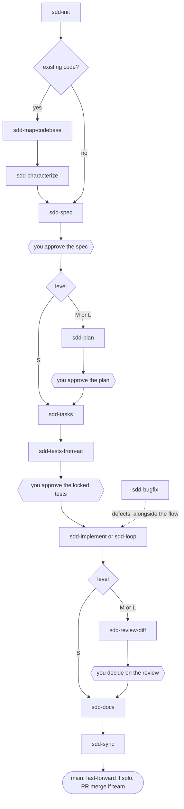

# SDD Playbook (version 0.20.0)

[](CHANGELOG.md)
[](LICENSE)
[](https://github.com/jumping2000/sdd-playbook/actions/workflows/ci.yml)
[](docs/scripts.md)
[](docs/architecture.md)
[](docs/architecture.md)
[](#installation)
[](#installation)
[](#installation)
[](#verification-status)
[](#documentation)
[](https://github.com/jumping2000/sdd-playbook/commits/main)
[](https://github.com/jumping2000/sdd-playbook)

*Versione italiana: [README_IT.md](README_IT.md)*

> **Status: in design.** The plugin has been tried once on a small real project (a Docker stack, with 0.17.0): its
> feedback (too much ceremony, too many manual steps) shaped 0.20.0. Formats and contracts may still change without
> compatibility.

**SDD Playbook** (`sdd-playbook`) is a spec-driven development plugin for Claude Code, Codex and GitHub Copilot that guides the developer through the whole software lifecycle described in the
[playbook](docs/playbook-ai-software-lifecycle.md): spec, plan, tasks, tests, implementation, review, documentation,
reconciliation, bug fixing and autonomous loop, with explicit human gates and deterministic checks.

**Core idea:** the instructions to the agent (skills) say *what to do and where to stop*; the scripts check *that it was
really done*. A check that runs is worth more than a prose rule.

**Start here:** [Quick guide](docs/quick-guide.md) — how to use it on a new or an existing project.

## Goal

Make software built with a coding agent **as trustworthy as software built by a disciplined team**, without asking the
developer to reread every line. In practice the plugin aims to ensure that:

1. the agent builds **what was decided**, written in an approved spec, and not what it guessed;
2. "done" means **verified by a command** (tests, lint, types, traceability), not "looks done";
3. the tests that define "done" are **written from the requirements and approved by a human** before the code;
4. the agent **does not touch what it must not touch**, especially in existing code;
5. the human decides at the **few points that matter**, with effort proportional to the risk of the change;
6. specs and documentation **stay aligned** with the real behaviour after every feature;
7. all of this works the same in **Claude Code, Codex and GitHub Copilot**, on **native Windows and Linux**, and remains verifiable in CI
   even without the plugin.

## Rationale: why this set of skills

Coding agents fail in recurring ways. Each skill and script exists to counter one of them:

| Typical failure of a coding agent | Answer in the plugin | Where |
|---|---|---|
| It guesses requirements and fills gaps with assumptions | Spec with requirements, acceptance criteria and explicit non-scope; open questions asked, not answered by the agent, and marked blocking or not; assumptions marked; vague words and glossary synonyms flagged; decision rights in `AGENTS.md` | `sdd-spec`, `spec_lint.py` |
| It declares "done" without evidence | One verification command as the definition of "done"; the `Stop` hook blocks a red stop; the loop ends only on objective checks | `verify.py`, `Stop` hook, `loop.py` |
| It writes tests that confirm its own bugs | Tests from the ACs, red for the right reason, locked by a `Test-Lock` commit and approved by a human; traceability AC → executed test | `sdd-tests-from-ac`, `trace_check.py --junit`, `diff_scope.py` |
| It changes or "improves" things outside the scope | Approved plan with the files to touch; forbidden zones and sensitive areas in `AGENTS.md`; diff checked against plan and level | `sdd-plan`, `diff_scope.py` |
| It breaks existing behaviour in a legacy codebase | Map and baseline first, characterization tests that can fail, spec of the delta only | `sdd-map-codebase`, `sdd-characterize` |
| It approves its own work (approvals are just text) | Approvals selected by the user among options and written by a script with name, date and hash; team profile: the real approval is a merge into protected `main` by a separate identity, with process checks in CI on the PR | `approve.py`, `spec_lint.py --base`, CI template, `CODEOWNERS` |
| Same heavy process for one line and for a migration | Levels S, M, L chosen by the user among options (the lowest the hard criteria allow is recommended), part of the spec hash; size is a warning, sensitive areas and dependencies are errors; few ACs for small changes | playbook §2.1, `diff_scope.py`, `spec_lint.py` |
| Too many manual steps, free-text approvals, git by hand | Questions in rounds of options; every gate an option with the approver's name; solo profile: the agent does branch, commits and fast-forward of `main` after the selected approval | `interaction.md` of `sdd-init`, `approve.py` |
| Review by the same session that wrote the code | Fresh-context reviewer, read-only by construction, that tries to refute; the human decides | `sdd-review-diff`, `sdd-reviewer` |
| Specs that rot after delivery | Closing task that reconciles spec, area page and code | `sdd-sync`, `sync_check.py` |
| Bugs fixed "by intuition", breaking something else | Reproduction, behaviour that must NOT change, red test, minimal fix | `sdd-bugfix`, `bug_lint.py` |
| Long autonomous runs that drift, stall or leak | Outer loop with cap, stall detection, timeout, pause for test approval, example permissions, isolation | `sdd-loop`, `loop.py`, `settings.loop.json` |
| Secrets and unreviewed dependencies slipping in | Secret scan in `verify`; dependencies only in the approved plan or with an ADR | `secrets_check.py`, `diff_scope.py` |
| Losing track of where the work is | One state machine read from files, not from the chat | `sdd-next`, `state.py` |

**Design choices behind it**
- **Skills for the process, scripts for the checks.** Skills are short instructions with a STOP at every approval point;
  scripts are deterministic, standard-library Python, copied into the project so that CI and VS Code use them without
  the plugin.
- **The human approves, the platform enforces.** Every text field can be written by the agent; a merge into a protected
  branch, done by a separate identity, cannot. That is why, in the team profile, the approval is the merge of the design
  PR and the CI template runs the process checks on PRs. In the solo profile (one person) the agent does the git steps
  right after an approval the user selected: simpler, with the limit stated in playbook §1.2.
- **Proportional, not uniform.** Levels S/M/L remove ceremony from small changes and add attention to risky ones.
- **State in files.** Specs, plans, tasks and reviews are versioned files; the chat is not a source of truth.
- **One content, three agents, two operating systems.** The Agent Skills format is shared by Claude Code, Codex and
  GitHub Copilot; the scripts avoid shell commands so that native Windows works like Linux.

**What it deliberately does not do:** approve on behalf of the human, launch the loop from inside a session, configure
the agent's permissions (it provides an example), cover release, infrastructure security and operations (playbook §8).

## What it contains

| Part | Content | Details |
|---|---|---|
| 14 skills | `sdd-next`, `sdd-init`, `sdd-map-codebase`, `sdd-characterize`, `sdd-spec`, `sdd-plan`, `sdd-tasks`, `sdd-tests-from-ac`, `sdd-implement`, `sdd-bugfix`, `sdd-review-diff`, `sdd-docs`, `sdd-sync`, `sdd-loop` | [docs/skills.md](docs/skills.md) |
| 13 Python scripts | `verify`, `state`, `spec_lint`, `trace_check`, `bug_lint`, `diff_scope`, `scan_repo`, `docs_check`, `sync_check`, `loop`, `secrets_check`, `review_package`, `approve` | [docs/scripts.md](docs/scripts.md) |
| 2 optional hooks | `Stop` (verify mandatory) and `PreToolUse` (guard), Claude Code only | [docs/scripts.md](docs/scripts.md#optional-hooks-claude-code-only) |
| 1 reviewer agent | `sdd-reviewer`, independent reviewer with read-only tools: Claude Code subagent and GitHub Copilot custom agent | [docs/architecture.md](docs/architecture.md) |
| Playbook | The process, with templates and scripts identical to the plugin's | [docs/playbook-ai-software-lifecycle.md](docs/playbook-ai-software-lifecycle.md) |

## Flow



`sdd-next` tells the next step at any time. More diagrams: spec states and gates in sequence in the
[playbook](docs/playbook-ai-software-lifecycle.md) (§3.3, §4), scripts and traceability model in the
[architecture](docs/architecture.md).

The process is proportional to risk: the spec declares a **level** S, M or L (playbook §2.1). S skips plan and
`review.md`; L adds an ADR and the human reading of the diff. The user chooses the level among options; `diff_scope.py`
reports a diff that breaks its hard criteria (sensitive area, dependencies) and warns on the size. Tests written from the ACs are locked by a `Test-Lock` commit and, at levels M and L, approved by the human before
implementation, with the SHA of the approved commit; with the JUnit report from `verify`, `trace_check.py --junit` counts
only executed, passing tests. Basic security: `secrets_check.py` as a `verify` step, new dependencies only in the plan or
with an ADR (`diff_scope.py`), example permissions for the loop (`skills/sdd-loop/references/settings.loop.json`).

Every skill that produces a document to approve ends with a **STOP**: the agent does not move on and does not approve by
itself. Every choice and every gate is asked as options to select (`Approve as <name>`, `Request changes`, `Stop
here`); the selected approval is written by `approve.py` (name, date, hashes, checked by the lint) and committed. Then,
by profile (`- Profile:` in `AGENTS.md`): **solo**, the agent moves `main` forward by fast-forward; **team**, the merge
of the PR into protected `main` is the approval, and the agent may offer to open or merge it with your explicit
approval.

## Quick start

1. Install the plugin (below).
2. In the project repository, ask the agent to use `sdd-init`. It copies the scripts into `scripts/` and creates
   `AGENTS.md`, `docs/`, the VS Code task and the CI.
3. `python scripts/state.py` (or the `sdd-next` skill) tells you where you are and what the next step is.
4. Continue with `sdd-spec` (greenfield) or `sdd-map-codebase` (existing code).

The full walkthrough, greenfield and brownfield, is in the [quick guide](docs/quick-guide.md).

The scripts stay **in the project**: verification in CI and from VS Code works even without the plugin. Each carries the
plugin version on line 2; to update them, ask `sdd-init` to compare them (it does not touch the `STEPS` of `verify.py`).

## Documentation

| Document | English | Italiano |
|---|---|---|
| Quick guide | [docs/quick-guide.md](docs/quick-guide.md) | [docs/quick-guide_IT.md](docs/quick-guide_IT.md) |
| Playbook (the process) | [docs/playbook-ai-software-lifecycle.md](docs/playbook-ai-software-lifecycle.md) | [docs/playbook-ai-software-lifecycle_IT.md](docs/playbook-ai-software-lifecycle_IT.md) |
| Skill reference | [docs/skills.md](docs/skills.md) | [docs/skills_IT.md](docs/skills_IT.md) |
| Script and hook reference | [docs/scripts.md](docs/scripts.md) | [docs/scripts_IT.md](docs/scripts_IT.md) |
| Architecture, contracts, limits | [docs/architecture.md](docs/architecture.md) | [docs/architecture_IT.md](docs/architecture_IT.md) |
| Change history | [CHANGELOG.md](CHANGELOG.md) | [CHANGELOG_IT.md](CHANGELOG_IT.md) |
| Critical review and fix status | [REVIEW.md](REVIEW.md) | [REVIEW_IT.md](REVIEW_IT.md) |

**Language.** Documentation, changelog and review exist in English and Italian (`_IT` suffix). The plugin itself (skills,
templates, scripts, hooks, agent, tests) is entirely in English; the field names it uses (`- Status:`, `- Level:`,
`tests approved:`, `expected: red`, ...) are file contracts read by the scripts and must not be translated.

## Installation

**Claude Code** (tried with Claude Code 2.1.312: the repository itself is the marketplace, `.claude-plugin/marketplace.json`)

```
/plugin marketplace add jumping2000/sdd-playbook
/plugin install sdd-playbook@sdd-playbook-marketplace
```

- The same from a terminal: `claude plugin marketplace add jumping2000/sdd-playbook`, then
  `claude plugin install sdd-playbook@sdd-playbook-marketplace`; `claude plugin list` shows the installed version.
- **A fixed version:** add the marketplace with a git ref, `jumping2000/sdd-playbook#v0.20.0` (every release has a tag
  `vX.Y.Z`). Without a ref the marketplace follows `main`; `/plugin marketplace update` fetches the latest.
- Local trial of a checkout: `claude --plugin-dir <path>/sdd-playbook`.
- Skills are invoked with the plugin prefix; hooks and subagent load with the plugin.

**Codex**
- The manifest is `.codex-plugin/plugin.json`. A Codex marketplace file is not included: its format must be checked
  against the documentation.
- Documented alternative for the skills only: copy the folders of `skills/` into `.agents/skills/` of the repository or of
  the home directory. A skill finds the files of another skill by search (`**/sdd-<name>/...`), not by a relative path,
  so the skills also work when installed one by one or with a host prefix in the folder name.
- Hooks and subagent are not provided for Codex: the independent review happens in a new session (see `sdd-review-diff`).

**GitHub Copilot**
- **Copilot CLI (plugin):** the root `plugin.json` (Agent Plugins format) declares the skills and the reviewer agent.
  Install with `copilot plugin install jumping2000/sdd-playbook`, or add the marketplace with
  `copilot plugin marketplace add jumping2000/sdd-playbook` (the CLI also reads `.claude-plugin/marketplace.json`).
- **Cloud agent, VS Code, Visual Studio (project files):** `sdd-init` asks which agents the team uses and, for Copilot,
  copies the skills into `.github/skills/` and the reviewer into `.github/agents/sdd-reviewer.agent.md` (tools `read`
  and `search` only). Copilot reads `AGENTS.md` directly, so the project rules and the `verify` command apply as they are.
- **Limits:** the `Stop` and `PreToolUse` hooks are not ported to Copilot (Copilot hooks have a different format and no
  blocking stop event): the safety net is CI, branch protection and the agent's own permissions. Loop with
  `--agent` set to the Copilot CLI: not verified. None of the Copilot paths has been tried yet (see the status below).

## Configuration

| Variable | Effect | Default |
|---|---|---|
| `SDD_ENFORCE_VERIFY=1` | Enables the `Stop` hook: the agent cannot stop with `verify` red | off |
| `SDD_VERIFY_ARGS` | Arguments of `verify.py` for the `Stop` hook (e.g. `--fast`) | empty (full verification) |
| `SDD_STOP_MAX` | How many times in a row the `Stop` hook blocks in the same session before letting the agent stop | 3 |
| `SDD_GUARD=1` | Enables the `PreToolUse` hook: blocks risky commands and reads (fail-closed) | off |

**Approvals.** Profile **solo**: nothing to configure, the agent does the git steps after the approval you select.
Profile **team**: for a control the agent cannot bypass, give it a separate identity (no push rights, or a bot account or
token without merge rights) and protect `main` with required PRs, code-owner review and CI. `sdd-init` creates
`.github/CODEOWNERS`, the PR template and the CI with process checks on PRs; you set the branch rules. Details:
playbook §1.2.

The hooks start from `hooks/run.sh`, which uses the first of `python3`, `python` and `py -3` and requires `sh` (on Windows,
the one from Git for Windows). In the red phase (last closed task "expected: red") the `Stop` hook does not block.

## Changing the plugin

- The playbook is edited in `tools/playbook-src/playbook.src.md` (English) and `tools/playbook-src/playbook_IT.src.md`
  (Italian), with the same section numbering; `python tools/build_playbook.py` regenerates both in `docs/`, which holds
  only the playbook to read. The `{{FILE ...}}` blocks embed the plugin's
  scripts and templates, so they cannot diverge.
- Tests: `python -m unittest discover -s tests -v`. They include the **coherence tests** between skills, scripts,
  playbooks and documentation in both languages (§ references, skill and script names, no version references in the
  playbook, every document in two languages, links).
- CI: `.github/workflows/ci.yml` runs the tests on Ubuntu and Windows.
- Release: the same version in the three manifests, in the marketplace entry, on line 2 of every script, in both
  changelogs and both READMEs (the coherence tests check it), then a git tag `vX.Y.Z` on the release commit.

## Verification status

| What | Result |
|---|---|
| Test suite | Passes on Linux (includes loop with fake agent, hooks and `run.sh` launcher, scripts on temporary git repositories). On Windows 11 verified up to 0.8.0; from 0.9.0 only the `windows-latest` CI matrix covers it, and its result must be checked |
| `claude plugin validate .` | Passed on 0.20.0 (Claude Code 2.1.312); only warning: no icon, needed just for the official plugin directory |
| Installation from the GitHub marketplace (Claude Code) | **Done** on 0.16.0: marketplace added from `jumping2000/sdd-playbook`, plugin installed and enabled; a git ref after `#` pins the version (tried with a branch) |
| Codex manifest | **Not validated** with a Codex tool |
| GitHub Copilot (`plugin.json`, `.github/skills/`, custom agent) | **Not tried**: built from the public documentation and examples (the GitHub docs site was not reachable from the build environment) |
| Python version | 3.8+ from code analysis (standard library only); CI runs 3.12 |
| Skills run by a real agent on a project | **Once**, with 0.17.0 on a small greenfield (Docker stack for Langfuse): the result was too heavy for the task; 0.20.0 addresses the findings and has not been tried on a project yet |
| Hooks in a real Claude Code session | **Not done**: tested only as scripts with the expected JSON input |
| `loop.py` with a real `claude -p` | **Not done**: tested with a fake agent |
| CI workflow generated by `sdd-init` | **Not run** (YAML validated, process-check step never executed on a real PR) |

Details and known limits: [docs/architecture.md](docs/architecture.md). Change history: [CHANGELOG.md](CHANGELOG.md).

## To complete before distribution

- Try the skills on a sample repository (greenfield and brownfield) and fix what a real agent misreads: the trial path is
  at the end of the [quick guide](docs/quick-guide.md).
- Verify on Codex: marketplace format, explicit skill invocation, possible subagent support.
- Verify on GitHub Copilot: plugin installation from the CLI, skills in `.github/skills/`, the `sdd-reviewer` custom agent,
  `loop.py` with the Copilot CLI as `--agent`.

## License

[MIT](LICENSE) © 2026 jumping2000
