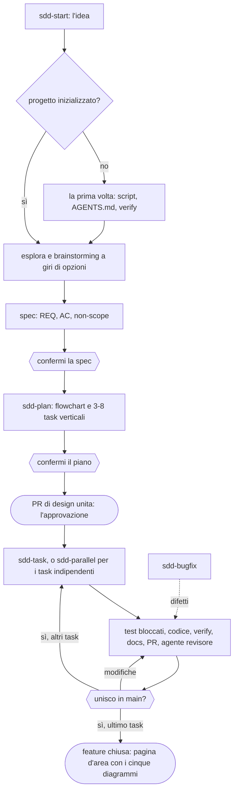

# SDD Playbook (versione 0.30.0)

[](CHANGELOG_IT.md)
[](LICENSE)
[](https://github.com/jumping2000/sdd-playbook/actions/workflows/ci.yml)
[](docs/scripts_IT.md)
[](docs/architecture_IT.md)
[](docs/architecture_IT.md)
[](#installazione)
[](#installazione)
[](#installazione)
[](#stato-della-verifica)
[](#documentazione)
[](https://github.com/jumping2000/sdd-playbook/commits/main)
[](https://github.com/jumping2000/sdd-playbook)

*English version: [README.md](README.md)*

> **Stato: in progettazione.** Provato una volta su un piccolo progetto reale (uno stack Docker, con la 0.17.0): era
> troppo pesante per il compito. La 0.30.0 è il metodo semplificato che risponde a quella prova; non è ancora stata
> provata su un progetto. Formati e contratti possono ancora cambiare senza compatibilità.

**SDD Playbook** (`sdd-playbook`) è un plugin di sviluppo guidato dalle specifiche per Claude Code, Codex e GitHub
Copilot: tu decidi **cosa** costruire e **se unirlo**, l'agente scrive spec, piano, test e codice, gli script
controllano che ogni passo sia stato fatto davvero. Il metodo sta in un [playbook](docs/playbook-ai-software-lifecycle_IT.md)
breve.

**Si parte da qui:** [Guida rapida](docs/quick-guide_IT.md).

## Obiettivo

Rendere affidabile il software costruito con un coding agent **senza cerimonia**:
1. l'agente costruisce **ciò che è stato deciso** in una spec confermata, e chiede invece di indovinare;
2. "fatto" vuol dire **verificato da un comando**, non "sembra fatto";
3. i test che definiscono "fatto" sono **scritti dai criteri di accettazione e bloccati prima del codice**, e un agente
   revisore indipendente li controlla;
4. il lavoro arriva in **PR verticali piccole**, una per task, e l'umano decide ogni merge con i risultati davanti;
5. spec e documentazione, diagrammi compresi, **restano allineate** al codice nella stessa PR;
6. funziona allo stesso modo in **Claude Code, Codex e GitHub Copilot**, su **Windows e Linux**, e resta verificabile
   senza il plugin.

## Come funziona



- **Tre tipi di decisione, sempre come opzioni da selezionare:** confermi la spec, confermi il piano (che elenca i
  task), unisci ogni PR. Nessun campo da firmare, nessuna approvazione scritta a mano: il merge è l'approvazione, git
  la registra.
- **Task verticali:** ognuno porta un comportamento con i suoi criteri di accettazione e sta in una PR rileggibile in
  15-30 minuti; da 3 a 8 per feature.
- **Prima i test, bloccati:** scritti dagli AC, committati con `Test-Lock: T-nn` prima del codice; `diff_scope.py`
  rifiuta ogni modifica successiva. Il revisore indipendente `sdd-reviewer` controlla che derivino dagli AC.
- **Agenti in parallelo** per i task indipendenti: un worktree, un branch e una PR ciascuno, uniti uno alla volta.
- `sdd-next` (o `python scripts/state.py`) indica in ogni momento il passo successivo, leggendo da git spec, piano e
  task uniti.

## Cosa contiene

| Parte | Contenuto | Dettagli |
|---|---|---|
| 7 skill | `sdd-start`, `sdd-plan`, `sdd-task`, `sdd-parallel`, `sdd-map`, `sdd-bugfix`, `sdd-next` | [docs/skills_IT.md](docs/skills_IT.md) |
| 8 script Python | `verify`, `spec_lint`, `trace_check`, `diff_scope`, `state`, `docs_check`, `secrets_check`, `scan_repo` | [docs/scripts_IT.md](docs/scripts_IT.md) |
| 2 hook opzionali | `Stop` (verify obbligatorio) e `PreToolUse` (guardia), solo Claude Code | [docs/scripts_IT.md](docs/scripts_IT.md#hook-opzionali-solo-claude-code) |
| 1 agente revisore | `sdd-reviewer`, indipendente e in sola lettura, rivede ogni PR: subagent di Claude Code e custom agent di GitHub Copilot | [docs/skills_IT.md](docs/skills_IT.md) |
| Playbook | Il metodo in dieci paragrafi brevi | [docs/playbook-ai-software-lifecycle_IT.md](docs/playbook-ai-software-lifecycle_IT.md) |

## Razionale

| Errore tipico di un coding agent | Risposta del plugin | Dove |
|---|---|---|
| Indovina i requisiti | Brainstorming a giri di opzioni, spec con AC, non-scope e anti-goal, domande aperte marcate bloccanti o no | `sdd-start`, `spec_lint.py` |
| Dichiara "fatto" senza prove | Un solo comando `verify`; l'hook `Stop` blocca una chiusura con verify rosso; CI facoltativa che esegue `verify` su ogni PR | `verify.py`, hook `Stop` |
| Scrive test che confermano i propri errori | Test dagli AC, bloccati prima del codice, rivisti da un agente indipendente; ogni AC tracciato a un test eseguito | `sdd-task`, `trace_check.py`, `diff_scope.py`, `sdd-reviewer` |
| Cambia cose fuori perimetro | Task con i loro file; zone vietate come errori; file fuori dal task e aree sensibili segnalati nella PR | `sdd-plan`, `diff_scope.py` |
| Diff enormi che nessuno legge | Task verticali, una PR ciascuno, un avviso oltre 400 righe modificate | `sdd-plan`, `sdd-task` |
| Troppa cerimonia per lavori piccoli | Un solo flusso per tutto; tre tipi di decisione; niente livelli, profili o approvazioni scritte a mano | playbook §3 |
| Rompe una codebase esistente | Prima mappa e baseline, test di caratterizzazione che possono fallire, spec della sola modifica | `sdd-map` |
| Spec e documentazione che invecchiano | Docs nella stessa PR; l'ultimo task scrive la pagina d'area con cinque diagrammi dal codice | `sdd-task`, `docs_check.py` |
| Bug corretti "a intuito" | Riproduzione, comportamento invariato, test rosso, causa verificata, correzione minima | `sdd-bugfix` |

**Cosa non fa di proposito:** unire senza la tua selezione, lanciare loop autonomi, configurare i permessi
dell'agente, coprire rilascio, infrastruttura e operazioni.

## Avvio rapido

1. Installa il plugin (sotto).
2. Nel repository del progetto chiedi all'agente: *"usa sdd-start per <la tua idea>"*. La prima volta inizializza
   anche il progetto (script in `scripts/`, `AGENTS.md`, `verify.py`).
3. Rispondi ai giri di opzioni, conferma la spec, poi `sdd-plan`, poi `sdd-task` per ogni task.

Gli script restano **nel progetto**: la verifica funziona in CI e da VS Code anche senza il plugin. Ognuno porta la
versione del plugin in seconda riga; `sdd-start` li aggiorna su richiesta (non tocca mai gli `STEPS` di `verify.py`).

## Documentazione

| Documento | English | Italiano |
|---|---|---|
| Guida rapida | [docs/quick-guide.md](docs/quick-guide.md) | [docs/quick-guide_IT.md](docs/quick-guide_IT.md) |
| Playbook (il metodo) | [docs/playbook-ai-software-lifecycle.md](docs/playbook-ai-software-lifecycle.md) | [docs/playbook-ai-software-lifecycle_IT.md](docs/playbook-ai-software-lifecycle_IT.md) |
| Riferimento delle skill | [docs/skills.md](docs/skills.md) | [docs/skills_IT.md](docs/skills_IT.md) |
| Riferimento di script e hook | [docs/scripts.md](docs/scripts.md) | [docs/scripts_IT.md](docs/scripts_IT.md) |
| Architettura, contratti, limiti | [docs/architecture.md](docs/architecture.md) | [docs/architecture_IT.md](docs/architecture_IT.md) |
| Storia delle modifiche | [CHANGELOG.md](CHANGELOG.md) | [CHANGELOG_IT.md](CHANGELOG_IT.md) |
| Review critica e stato delle correzioni | [REVIEW.md](REVIEW.md) | [REVIEW_IT.md](REVIEW_IT.md) |

**Lingua.** Documentazione, changelog e review esistono in inglese e in italiano (suffisso `_IT`). Il plugin (skill,
template, script, hook, agente, test) è in inglese; i nomi dei campi che usa (`- Status:`, `covers:`, `depends:`,
`Test-Lock:`, ...) sono contratti letti dagli script e non vanno tradotti.

## Installazione

**Claude Code** (provato con Claude Code 2.1.312: il repository stesso è il marketplace, `.claude-plugin/marketplace.json`)

```
/plugin marketplace add jumping2000/sdd-playbook
/plugin install sdd-playbook@sdd-playbook-marketplace
```

- Lo stesso da terminale: `claude plugin marketplace add jumping2000/sdd-playbook`, poi
  `claude plugin install sdd-playbook@sdd-playbook-marketplace`; `claude plugin list` mostra la versione installata.
- **Una versione fissa:** aggiungi il marketplace con un riferimento git, `jumping2000/sdd-playbook#v0.30.0` (ogni
  rilascio ha un tag `vX.Y.Z`). Senza riferimento il marketplace segue `main`; `/plugin marketplace update` scarica
  l'ultima.
- Prova locale di una copia: `claude --plugin-dir <percorso>/sdd-playbook`.
- Le skill si invocano con il prefisso del plugin; hook e subagent si caricano con il plugin.

**Codex**
- Il manifest è `.codex-plugin/plugin.json`. Un file di marketplace per Codex non è incluso.
- Solo le skill: copia le cartelle di `skills/` in `.agents/skills/` del repository o della home. Una skill trova i file
  di un'altra con una ricerca (`**/sdd-<nome>/...`), quindi funziona anche installata da sola.
- Niente hook né subagent per Codex: la review indipendente avviene in una nuova sessione (vedi `sdd-task`).

**GitHub Copilot**
- **Copilot CLI (plugin):** il `plugin.json` alla radice (formato Agent Plugins) dichiara le skill e l'agente revisore.
  Installa con `copilot plugin install jumping2000/sdd-playbook`, oppure aggiungi il marketplace con
  `copilot plugin marketplace add jumping2000/sdd-playbook`.
- **Cloud agent, VS Code, Visual Studio:** `sdd-start` copia le skill in `.github/skills/` e il revisore in
  `.github/agents/sdd-reviewer.agent.md` (solo strumenti `read` e `search`). Il coding agent di Copilot, che lavora una
  issue per PR, si adatta al flusso un task, una PR.
- **Limiti:** gli hook non sono portati su Copilot. Nessuno dei percorsi Copilot è ancora stato provato.

## Configurazione

| Variabile | Effetto | Default |
|---|---|---|
| `SDD_ENFORCE_VERIFY=1` | Attiva l'hook `Stop`: l'agente non può fermarsi con `verify` rosso | disattivo |
| `SDD_VERIFY_ARGS` | Argomenti di `verify.py` per l'hook `Stop` (es. `--fast`) | vuoto (verifica completa) |
| `SDD_STOP_MAX` | Quante volte di fila l'hook `Stop` blocca nella stessa sessione prima di lasciar fermare l'agente | 3 |
| `SDD_GUARD=1` | Attiva l'hook `PreToolUse`: blocca comandi e letture a rischio (fail-closed) | disattivo |

**Merge.** L'agente unisce solo dopo che hai selezionato `Merge into main`. Niente di tecnico impedisce a un agente di
unire da solo: se ti serve una garanzia, proteggi `main` sulla piattaforma (review obbligatoria), un'impostazione fuori
dal plugin.

Gli hook partono da `hooks/run.sh`, che usa il primo tra `python3`, `python` e `py -3` e richiede `sh` (su Windows,
quello di Git for Windows). Nella fase rossa di un task (ultimo commit `Test-Lock: T-nn`) l'hook `Stop` non blocca.

## Modificare il plugin

- Il playbook è un documento normale in `docs/` (inglese e italiano, stessa numerazione dei paragrafi); cita template
  e skill invece di copiarli.
- Test: `python -m unittest discover -s tests -v`, compresi i **test di coerenza** tra skill, script, template e
  documentazione nelle due lingue.
- CI: `.github/workflows/ci.yml` esegue i test su Ubuntu e Windows.
- Rilascio: la stessa versione nei tre manifest, nella voce del marketplace, in seconda riga di ogni script, nei due
  changelog e nei due README (i test di coerenza lo controllano), poi un tag git `vX.Y.Z`.

## Stato della verifica

| Cosa | Esito |
|---|---|
| Suite di test | Passa su Linux (script su repository git temporanei, il flusso completo di una feature attraverso `state.py`, hook e launcher `run.sh`); la matrice CI `windows-latest` copre Windows |
| `claude plugin validate .` | Passa sulla 0.30.0 (Claude Code 2.1.312); unico avviso: manca l'icona, che serve solo per la directory ufficiale dei plugin |
| Installazione dal marketplace su GitHub (Claude Code) | **Fatta** sulla 0.16.0; un riferimento git dopo `#` fissa la versione (provato con un branch) |
| Manifest Codex | **Non validato** con uno strumento Codex |
| GitHub Copilot (`plugin.json`, `.github/skills/`, custom agent) | **Non provato** |
| Versione di Python | 3.8+ dall'analisi del codice (sola libreria standard); la CI usa la 3.12 |
| Skill eseguite da un agente reale su un progetto | **Una volta**, con la 0.17.0 (troppo pesante per il compito); la 0.30.0 non ancora provata |
| Agenti in parallelo nei worktree | **Non provato** con un agente reale |
| Hook in una sessione reale di Claude Code | **Non fatto**: provati solo come script con l'input JSON atteso |

Dettagli e limiti noti: [docs/architecture_IT.md](docs/architecture_IT.md). Storia delle modifiche:
[CHANGELOG_IT.md](CHANGELOG_IT.md).

## Da completare prima di distribuirlo

- Rifare lo stack Docker di Langfuse con la 0.30.0 e confrontarlo con la prima prova (il percorso è in fondo alla
  [guida rapida](docs/quick-guide_IT.md)).
- Provare `sdd-parallel` con due task indipendenti.
- Verificare su Codex e GitHub Copilot.

## Licenza

[MIT](LICENSE) © 2026 jumping2000
