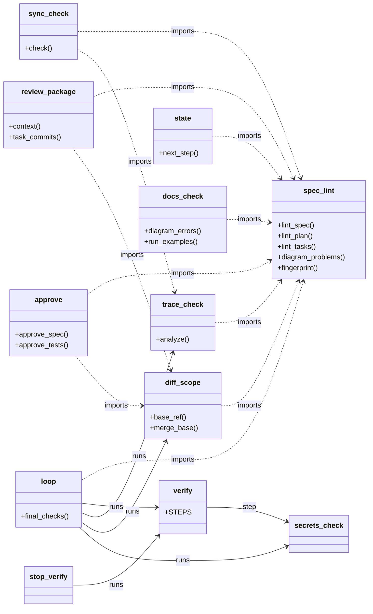
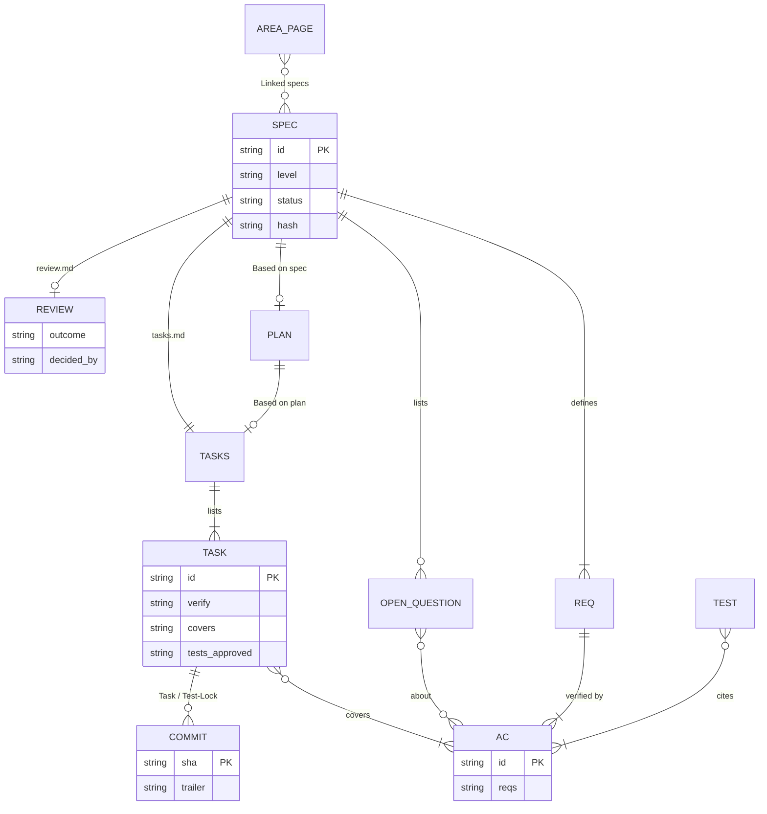

# Plugin architecture

*Versione italiana: [architecture_IT.md](architecture_IT.md)*

Design document **as built** (version 0.20.0): choices, structure, contracts between files and limits.

## Goal and success criterion

Guide the developer through the cycle of the [playbook](playbook-ai-software-lifecycle.md), turning every phase into a
skill with an explicit human gate and, wherever possible, an executable check instead of a prose instruction.
The plugin is done well if:
1. on an empty repository `sdd-init` produces `AGENTS.md`, `scripts/verify.py`, VS Code task, `docs/` structure and CI;
2. every skill produces a verifiable artefact (file, test, script result), not just text in the chat;
3. the same content works in Claude Code, Codex and GitHub Copilot, on native Windows and Linux;
4. working with the skills does not require repeating the playbook to the agent.

## Architecture choices

| Topic | Choice | Reason |
|---|---|---|
| Content unit | **Skill** (`SKILL.md` with `name` and `description`) | The Agent Skills format is shared by Claude Code, Codex and GitHub Copilot |
| Packaging | One repository, **three manifests** (`.claude-plugin/plugin.json`, `.codex-plugin/plugin.json`, root `plugin.json` in the Agent Plugins format for the Copilot CLI) on the same skills | One body of content, three entry points |
| Checks | **Deterministic Python scripts** in the project's `scripts/` | A check that runs is worth more than a prose rule; CI and VS Code use them without the plugin |
| Where scripts live | In `skills/sdd-init/scripts/`, copied into the project by `sdd-init`, with the plugin version on line 2 | Fixed path (`python scripts/...`) for both agents; the project stays verifiable without the plugin |
| Portability | Standard library only, no shell commands, argument lists; skills never read another skill's files through `../` but find them by search | Native Windows included; hosts that install skills one by one or rename their folders |
| Context | `SKILL.md` under 150 lines; templates in `references/` | Context is a scarce resource |
| Human gates | Every skill that produces a document to approve ends with **STOP**; every choice and gate is asked as options to select (`interaction.md` of `sdd-init`); the selected approval is written by `approve.py` with name, date and hash of the approved content (which lapses if the content changes) | Playbook principle 5; free-text approvals and hand-computed hashes caused errors in the first real trial |
| Profiles | `- Profile: solo \| team` in `AGENTS.md`. **solo**: the agent does branch, commits and fast-forward of `main` (`git fetch . HEAD:main`) right after a selected gate; no CODEOWNERS or PR template. **team**: the real approval is merging the PR into protected `main`, which the agent cannot do with a separate identity | A team rule (PR, CODEOWNERS, never touch `main`) on a one-person project without a remote produced only manual git steps and errors; in a team the platform remains the control the agent cannot bypass |
| Proportionality | Levels **S/M/L** chosen by the user among options and declared in the spec (and in its hash); `diff_scope.py` enforces only the hard criteria (sensitive area → L, dependencies → M) and warns on size; process tooling never counts; `spec_lint.py` warns on too many ACs | The same process for one line and for a migration creates ceremony on the former and too little attention on the latter (REVIEW A6) |
| External control | The CI generated by `sdd-init` runs the process checks on PRs (`spec_lint --base`, `diff_scope`, `trace_check --junit`, `secrets_check`) with scripts and `AGENTS.md` protected by CODEOWNERS | Every input in the branch can be changed by the agent; CI on the PR runs outside its reach |
| Independent review | Per task at level L (optional at M, `- Task review: on`) and per feature, always by the same read-only `sdd-reviewer`; `review_package.py` puts in one file what the reviewer needs; passed task reviews are checked by `state.py`, `sync_check.py` and `loop.py` | A single review at the end of a large diff finds errors late and misses details (REVIEW, section C); a per-task review stops them before the next task builds on them, without adding a second agent to maintain |
| Effectful skills | `sdd-loop` prepares but does not launch; feature commits never on `main`; `main` moves only by the merge of an approved PR (team) or by fast-forward after a selected gate (solo) | Limit the damage of an autonomous agent |
| Agent-specific parts | Claude Code: subagent `sdd-reviewer` (read-only tools) and opt-in hooks. GitHub Copilot: the same reviewer as a custom agent (`*.agent.md`, tools `read` and `search`), skills copied into `.github/skills/` by `sdd-init` for the cloud agent and the IDEs. Codex: none (review in a new session) | The skills stay the same; only the orchestration changes |
| Documentation coherence | The playbook is **generated** from its sources in `tools/playbook-src/` and the plugin files (`tools/build_playbook.py`), in English and Italian; tests check cross-references in both languages | Scripts, templates and documentation cannot silently diverge |
| Diagrams | **Mermaid** blocks in Markdown: in the plugin's documentation and, through templates and checks, in the documentation of the applications it builds (plan, area pages, map: flowchart, sequence, state, class, ER, each drawn or `n/a` with a reason) | Rendered by GitHub and GitLab with no tool to install, reviewed as text in the diff; a script can check that they exist and have the right type, not that they are true: that is the reviewer's job |
| Language | Documentation, changelog and review in English and Italian (`_IT` suffix); the plugin (skills, templates, scripts, hooks, agent, tests) entirely in English | One language for the file contracts (field names read by the scripts), independent of the language of the docs |

## Repository structure

```
sdd-playbook/
├── README.md, README_IT.md, CHANGELOG.md, CHANGELOG_IT.md, REVIEW.md, REVIEW_IT.md, LICENSE (MIT)
├── plugin.json            Copilot CLI manifest (Agent Plugins format)
├── .claude-plugin/        plugin.json, marketplace.json
├── .codex-plugin/         plugin.json
├── skills/
│   ├── sdd-init/         SKILL.md, scripts/ (13 scripts), references/ (templates, CI, tasks.json, stacks, interaction, copilot/)
│   ├── sdd-map-codebase/ SKILL.md, references/map-template.md
│   ├── sdd-characterize/ SKILL.md
│   ├── sdd-spec/         SKILL.md, references/spec-template.md
│   ├── sdd-plan/         SKILL.md, references/plan-template.md, diagrams.md
│   ├── sdd-tasks/        SKILL.md, references/tasks-template.md
│   ├── sdd-tests-from-ac/ SKILL.md, references/test-conventions.md
│   ├── sdd-implement/    SKILL.md
│   ├── sdd-bugfix/       SKILL.md, references/bugfix-template.md
│   ├── sdd-review-diff/  SKILL.md, references/review-template.md
│   ├── sdd-docs/         SKILL.md
│   ├── sdd-sync/         SKILL.md, references/area-template.md
│   ├── sdd-loop/         SKILL.md, references/PROMPT.md.tmpl, progress.md.tmpl, settings.loop.json
│   └── sdd-next/         SKILL.md
├── agents/sdd-reviewer.md       subagent (Claude Code); Copilot copy in skills/sdd-init/references/copilot/
├── hooks/                        hooks.json, run.sh (launcher), stop_verify.py, pretool_guard.py (Claude Code, opt-in)
├── docs/                         English and Italian (_IT): quick guide, playbook (generated), skills, scripts,
│                                 architecture
├── tools/                        build_playbook.py and playbook-src/ (the playbook sources, EN and IT)
├── tests/                        tests of scripts, hooks, loop and coherence
└── .github/workflows/ci.yml      tests on Ubuntu and Windows
```

A skill reads its own files with paths relative to its folder and finds the files of another skill by search
(`**/sdd-sync/references/area-template.md`), never with `../`: a host may install skills one by one or add a prefix to
the folder name. The coherence tests reject `../` in skill files and check every cited path.

How the scripts depend on each other (modules drawn as classes, with their main functions): `spec_lint` holds the
parsing shared by the others; `loop` and the `Stop` hook run the checks as separate processes.



## State machine (`state.py`)

```
no AGENTS.md / verify.py ................................ sdd-init
existing code, no map and no spec ....................... sdd-map-codebase
no active spec .......................................... sdd-spec
several active specs, no choice (branch or --spec) ...... choose (the user decides)
--- for the chosen spec ---
spec in-revision ....................................... sdd-spec
spec draft, not approved or with invalid hash ........... sdd-spec
--- level S: no plan, no review.md -----------------------
tasks.md missing ........................................ sdd-tasks
solo profile, design approved but not on main ........... sdd-tasks (git fetch . HEAD:main)
next task covers an AC of a non-blocking question ....... sdd-spec (answer it, revise the spec)
open T-nn or T-Rnn tasks ................................ sdd-implement
review.md "non-compliant" (if present) ................... sdd-review-diff
T-DOC open, otherwise ................................... sdd-docs, sdd-sync
--- levels M (default) and L -----------------------------
plan missing, not approved or lapsed .................... sdd-plan
tasks.md missing or based on another plan ............... sdd-tasks
solo profile, design approved but not on main ........... sdd-tasks (git fetch . HEAD:main)
closed test task without "tests approved:" .............. sdd-tests-from-ac
next task covers an AC of a non-blocking question ....... sdd-spec (answer it, revise the spec)
open T-nn or T-Rnn tasks ................................ sdd-implement   (consider sdd-loop)
task review missing (L, or M with "Task review: on") .... sdd-implement
review.md missing or without a valid outcome ............ sdd-review-diff
review "non-compliant" without T-R ....................... sdd-review-diff (create the T-R tasks)
review "non-compliant" with all T-R closed ............... sdd-review-diff (repeat the review)
level L without "Human diff review" .............. sdd-review-diff
T-DOC open .............................................. sdd-docs
otherwise (T-SYNC open or state not implemented) ........ sdd-sync
```

The chosen spec is the one given with `--spec`, the one whose folder name appears in the current branch, or the only
active one. A spec with `Status: implemented` or `superseded` is no longer active. Unverified bugs are reported separately
(`sdd-bugfix`): the human decides the priority.

## File contracts

The scripts read a few fields with fixed conventions. Field names are English and are part of the contract. If a template
changes, the script that reads it must change too (the tests check this).

| File | Fields and structures read | Script |
|---|---|---|
| `spec.md` | title `# SPEC-<id>: ...` (date + slug equal to the folder, or a number); `- Level:` (`S`, `M`, `L`; M if missing; read from the header only; part of the hash); `- Status:` (`draft`, `approved`, `in-revision`, `implemented`, `superseded`); section `## Revisions` (mandatory with an entry if `in-revision`); `- Approved by / date:`; `- Hash: sha256:...` of the body (from the first `## ` section); sections `## Problem and goal`, `Scope`, `Requirements`, `Acceptance criteria`, `Open questions`; line `**Non-scope (explicit):**`; line `**Anti-goals:**` (warning if missing); `- REQ-nnn`; `- AC-nnn [REQ-nnn]`; marker `[ASSUMPTION]`; open questions `- <question> — blocking: yes|no — about: REQ-nnn, AC-nnn` | `spec_lint`, `state`, `trace_check`, `sync_check`, `diff_scope` |
| `plan.md` | `- Approved by / date:`; `- Based on spec:` (hash of the spec); `- Hash:` of the body; section `## Components and files to create/modify` with lines `- path: ...` (path = first word or text in backticks); section `## Test strategy ...` with the exact AC IDs and, if present, the `Where` column; section `## Review focus` (table with a `Where` column, or `- none`); section `## Diagrams` with `### Flowchart`, `### Sequence diagram`, `### State diagram`, `### Class diagram`, `### ER diagram`, each a ```` ```mermaid ```` block whose first keyword is the type, or `- n/a: <reason>` (never the flowchart) | `spec_lint`, `state`, `diff_scope`, `review_package` |
| `tasks.md` | `- Based on plan:` (hash of the plan); lines `- [ ] T-nn ...` with the fields `verify:` (command in backticks) and `covers:` (AC IDs), without placeholders; lines `- [ ] T-Rnn ...` from review problems (`verify:`, `covers:` optional); `T-DOC`, `T-SYNC`; `— tests approved: <name, yyyy-mm-dd, sha>` on closed test tasks (levels M and L; sha = approved `Test-Lock` commit); the marker `expected: red` (case-insensitive) on test tasks defines the **red phase** (last closed `T-nn` task with the marker, next one open) | `spec_lint`, `state`, `loop`, `sync_check`, `diff_scope`, `Stop` hook |
| git commits | trailer `Test-Lock: T-nn` on the commit of the red tests: locks its test files and anchors the approval; trailer `Task: T-nn` on the implementation commits | `diff_scope`, `review_package` |
| test files | `# SPEC-<id>` in the file plus `AC-nnn`, or citations `SPEC-<id>/AC-nnn` (in function names `SPEC_<id with _>_AC_nnn`); `TODO`/`FIXME`/`XXX` lines ignored | `trace_check`, `sync_check` |
| folders `docs/specs/<id>/` | `<id>` = date + slug (`2026-10-24-export-csv`), equal to the title ID; old `NNN-slug` still valid | `spec_lint`, `state` (branch association) |
| JUnit XML report (`reports/junit.xml`) | `testcase` with `name`, `classname`, `file` and children `failure`, `error`, `skipped` | `trace_check --junit`, `sync_check --junit`, `loop --junit` |
| `review.md` | `- Outcome:` (`compliant`, `compliant with reservations`, `non-compliant`); `- Decided by:`; `- Human diff review:` (level L) | `state`, `sync_check` |
| `docs/bugs/BUG-*.md` | `- Status:` (`open`, `diagnosed`, `fixed`, `verified`); sections of `bugfix-template.md`; tickable items in `## Closure` | `bug_lint`, `state` |
| `docs/system/<area>.md` | `- Last aligned:`; `- Linked specs:`; sections `## Current behaviour`, `Constraints and delicate points`, `Characterization tests`; section `## Diagrams` as in `plan.md` | `sync_check`, `docs_check` |
| `docs/system/map.md` | presence; section `## Diagrams` as in `plan.md` | `state`, `docs_check` |
| `AGENTS.md` | lines `- Do not modify: a, b` and `- Sensitive areas: a, b` (require level L), paths in backticks or first word; read from the merge-base. Section `## Decision rights` with `### Decides alone`, `### Asks first`, `### Never` (read by the agents, not by the scripts). Section `## Process` with `- Profile: solo \| team` (team when missing) and `- Approvers:` (names offered in the gates) | `diff_scope`, `state` (profile); `sdd-implement`, loop, `sdd-reviewer`, every gate |
| `docs/glossary.md` (optional) | table with the columns `Term` and `Avoid` (synonyms, comma-separated) | `spec_lint` |
| `PROMPT.md`, `progress.md` | `PROMPT.md` read in full and passed on stdin; `progress.md`: `- Task review: on` (level M), `## Task reviews` with `- T-nn: pass` per closed task (level L, or M when on), `## Rulings` and `## Disputed review findings` read by the reviewer | `loop`, `state`, `sync_check`, `review_package`, `sdd-reviewer` |
| `scripts/verify.py` | list `STEPS` | (adapted by `sdd-init`) |
| `scripts/*.py` | line 2 `# sdd-playbook: <version>` | `sdd-init` (update), coherence tests |
| manifests and lockfiles (`package.json`, `pyproject.toml`, `*.csproj`, ...) | file name only | `diff_scope` (level, dependencies without plan or ADR) |
| `.secrets-ignore` | one glob per line, `#` for comments | `secrets_check` |

A field with a `<...>` placeholder or empty counts as **not filled in**.

The traceability model these contracts build, from the spec to the commits:



## Differences between Claude Code, Codex and GitHub Copilot

| Aspect | Claude Code | Codex | GitHub Copilot |
|---|---|---|---|
| Skills | yes, invoked with the plugin prefix | yes (Agent Skills format); manifest in `.codex-plugin/` | Copilot CLI: plugin from the root `plugin.json`; cloud agent and IDEs: `.github/skills/` copied by `sdd-init` |
| Reviewer `sdd-reviewer` | subagent | no: the review happens in a new session with the same instructions | custom agent `.github/agents/sdd-reviewer.agent.md` (tools `read`, `search`) |
| `Stop` and `PreToolUse` hooks | yes, opt-in with environment variables | not provided | not ported (different format, no blocking stop event) |
| Loop | `claude -p` by default | `--agent "<command>"`: non-interactive mode and permissions to verify | `--agent "<copilot CLI command>"`: not verified |
| Project context | `CLAUDE.md` with `@AGENTS.md` | reads `AGENTS.md` | reads `AGENTS.md` |

## Security and supply chain

- The skills instruct the agent and the scripts run with the user's permissions: distribute the plugin from an internal
  repository, with mandatory review, a pinned version per project and updates through PRs.
- No script downloads or runs code from the network. `docs_check.py --run-examples` runs only explicitly marked Python blocks.
- The hooks are inactive by default and are not a sandbox. The guard also blocks on an unreadable event (fail-closed). The
  loop requires an isolated environment, separately configured permissions (example: `settings.loop.json`, which also
  denies writes to the loop's checks and rules) and a feature branch; it never pushes.
- Security of the produced code (REVIEW A7): `secrets_check.py` as a `verify` step and as a final check of the loop; new
  dependencies only in the approved plan or with a new ADR (`diff_scope.py`); dependency audit documented per stack, not
  included (it needs the network).
- Prompt injection: `PROMPT.md` and the reviewer treat repository content as data; the real defence is the absence of
  secrets and of network and push permissions in the agent's environment.
- The CI generated by `sdd-init` uses actions pinned by major tag (`checkout@v6`, `setup-python@v6`, on Node 24): in
  regulated contexts pin them by SHA.

## Limits and unverified points

- **Status:** the plugin is in design; it was tried once on a small real project (0.17.0, a Docker stack) and 0.20.0
  answers that trial; formats and contracts may still change without compatibility.
- **Windows:** suite run on Windows 11 (Python 3.13, cp1252 console) up to 0.8.0, then only in the CI matrix; the tests
  of `run.sh` with minimal PATH and fake interpreters run only on POSIX.
- **Real agents:** one trial with Claude Code on a small greenfield (0.17.0); options, profiles and `approve.py` (0.20.0)
  are tested only by the suite (temporary repositories, an end-to-end solo flow) and not yet by a real agent.
- **Codex:** manifest and skill invocation not validated with Codex tools; subagent support not verified.
- **GitHub Copilot:** root `plugin.json`, skills in `.github/skills/` and custom agent built from the public
  documentation and examples (the GitHub documentation site was not reachable from the build environment); none of them
  has been tried with Copilot. If the Copilot CLI also reads `hooks/hooks.json`, the commands would run without
  `CLAUDE_PLUGIN_ROOT` and the hooks would not start: not verified.
- **Claude Code hooks:** exit code 2 as a block and the JSON format are the expected ones, not observed in a session. The
  command goes through `sh hooks/run.sh`: on Windows it requires Claude Code to run hooks with a shell that finds `sh`
  (Git for Windows); not verified in a real session.
- **Approvals:** the hash stops unintentional drift, not an agent that recomputes the hash and rewrites the field.
  Against that, the merge into protected `main` with a separate identity (`spec_lint.py --base`) and the CI process
  checks are needed: branch protection and CODEOWNERS must be configured on the platform, the plugin provides only the
  templates. **Solo profile:** nothing technical stops an agent from running `approve.py` or `git fetch . HEAD:main` by
  itself; the evidence is the user's selection in the host's question tool and the commit that follows. It is accepted
  for one-person projects; with a shared remote, use the team profile.
- **Red phase, `Test-Lock` and `tests approved:`:** they rely on conventions (task markers, commit trailers) the agent
  could misuse; `diff_scope.py` ties the approval to the `Test-Lock` SHA, but `tests approved:` remains text the agent can
  write: the control it cannot bypass is the code-owner review of `tests/` in the implementation PR.
- **JUnit report:** it tells which tests ran and with which outcome, not that the report belongs to that commit: it must
  be generated by `verify` in the same pass (in CI, by a job the agent does not control). Case-to-file attribution uses
  `file` and `classname`: with reporters that do not fill them in, qualified citations are needed.
- **`claude -p` from stdin:** reading the prompt from stdin with `-p` must be verified on the version in use.
- **Heuristics:** `diff_scope.py` depends on the `- path: ...` format of the plan and, for the level, counts files and
  recognizes manifests by name: it does not understand whether a public interface changed; `trace_check.py` finds IDs by
  text (qualified per spec) and does not understand test semantics; without `--junit` it does not check that tests run
  and pass; `scan_repo.py` is an inventory; none of them replaces reading the code.
- **Guard and secrets:** the guard analyses commands by words and segments, but a purpose-built command (variables,
  `eval`, scripts written to file) bypasses it; `secrets_check.py` recognizes only known formats and does not read the git
  history.
- **Reviewer:** without Bash it cannot run tests or commands; it receives diff and outputs in the message, so it judges
  what it is given. Same model as the implementer unless a different `model:` is set in the frontmatter (not verified in a
  session).
- **Scope:** the plugin does not cover release, infrastructure security, observability and operations (playbook §8),
  does not configure the agent's permissions (it provides an example for the loop) and does not approve on behalf of the
  human.

## Tests and coherence

`python -m unittest discover -s tests -v`. Besides the tests of the scripts (on temporary git repositories), of the loop
(with a fake agent that ticks one task per run) and of the hooks, the **coherence tests** check that:
- every `SKILL.md` has valid frontmatter, `name` equal to the folder and fewer than 150 lines, `name` and `description`
  within the limits of the Agent Skills format;
- no skill file contains `../`, every path a skill cites (its own `references/` or another skill's by search) exists;
- the templates match the scripts: review focus, anti-goals, `blocking:` in the open questions, the three decision
  rights lists in `AGENTS.md` and in the skills, agent and loop prompt that follow them; `## Process` with `- Profile:`
  and `- Approvers:`, the `approve.py` rule in the `AGENTS.md` template, and every skill with a STOP citing
  `interaction.md`;
- every cited `python scripts/<x>.py` exists and every script is documented, in both languages;
- every skill is in both READMEs, both skill references, both quick guides and both playbooks, and every cited skill exists;
- every cited `§` exists as a playbook heading, and the two playbooks have the same section numbering;
- both playbooks are up to date with the embedded files (`tools/build_playbook.py --check`) and contain no version references;
- every document (changelog and review included) exists in English and Italian, and each links to the other language;
- the plugin files (skills, agent, hooks, tools, tests, manifests) contain no Italian text, except the Italian playbook
  source in `tools/playbook-src/`;
- the three manifests, both changelogs and both READMEs have the same version (README badge included), every script
  carries it on line 2, and the license is MIT;
- the reviewer (Claude Code and Copilot) has no write tools, the loop example permissions deny push and writes to the checks, and the CI actions do
  not use versions on Node 20;
- the relative links of the documentation are valid and its Mermaid blocks have a known type (`docs_check.py`); the
  plan, area and map templates have the five diagram subsections and the diagram guide names them all.

## Possible evolutions

Release and operations (playbook §8), integration with issue trackers, a marketplace file for Codex, Copilot hooks,
multi-repository analysis. They are neither documented nor implemented in this version.
