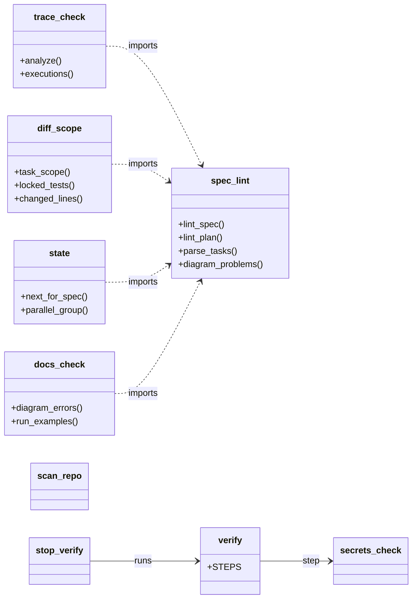
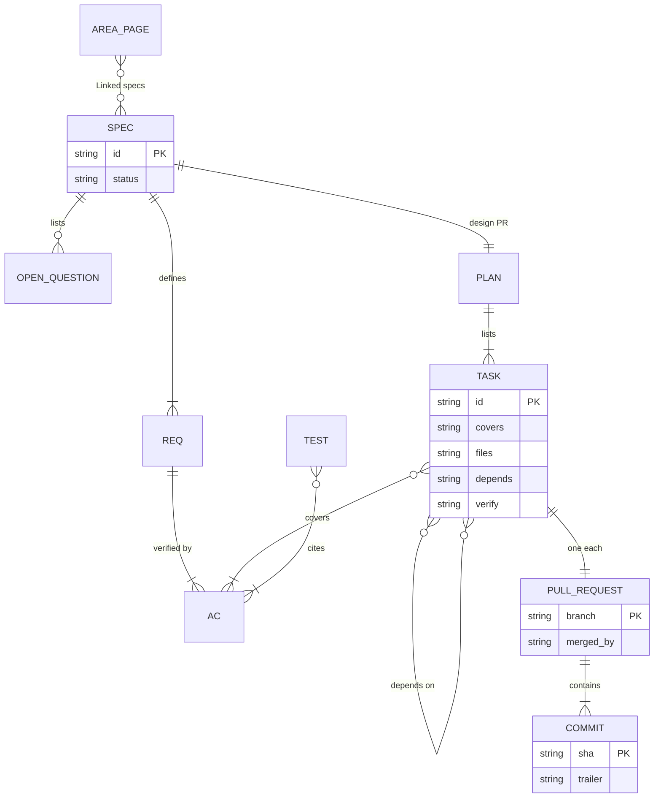

# Plugin architecture

*Versione italiana: [architecture_IT.md](architecture_IT.md)*

Design document **as built** (version 0.30.0): choices, structure, contracts between files and limits.

## Goal and success criterion

Guide the developer through the [playbook](playbook-ai-software-lifecycle.md) with the least ceremony that keeps the
result trustworthy. The plugin is done well if:
1. a feature goes from idea to `main` with three kinds of human decision (spec, plan, one merge per PR), all as options;
2. every step produces a verifiable artefact (file, test, script result, PR), not just text in the chat;
3. the same content works in Claude Code, Codex and GitHub Copilot, on native Windows and Linux;
4. every mechanism covers a risk no other mechanism covers (**one risk, one mechanism**).

## Architecture choices

| Topic | Choice | Reason |
|---|---|---|
| Content unit | **Skill** (`SKILL.md` with `name` and `description`), 7 skills | The Agent Skills format is shared by Claude Code, Codex and GitHub Copilot; fewer skills, fewer hand-offs |
| Packaging | One repository, **three manifests** (`.claude-plugin/plugin.json`, `.codex-plugin/plugin.json`, root `plugin.json` for the Copilot CLI) on the same skills | One body of content, three entry points |
| Checks | **Deterministic Python scripts**, standard library only, copied into the project's `scripts/` by `sdd-start` | A check that runs is worth more than a prose rule; the project stays verifiable without the plugin |
| Approval | **The merge of a PR**, decided by the user with an option: the design PR approves spec and plan, each task PR approves its code | Git records who merged what; hashes, signed fields and approval scripts covered the same risk and produced manual steps and errors in the first real trial |
| Proportionality | **One flow for everything**; small vertical tasks make small PRs; sensitive areas flagged in the PR, not a process level | Levels S/M/L and solo/team profiles multiplied the variants without covering a new risk |
| Tests | Written from the ACs, **locked** (`Test-Lock` commit) before the code, checked by `diff_scope.py` and by the reviewer agent; no human approval of single tests | The risk of tests that confirm the agent's bugs stays covered by a machine check and an independent agent |
| Independent review | `sdd-reviewer`, read-only, **one review per PR** | One review where the diff is small, instead of per-task review plus a final review of a large diff |
| Parallelism | Independent tasks (no dependency, disjoint files in the plan) in separate worktrees, one PR each, merged one at a time | Saves time where it is safe; the plan, not the agent, decides what is independent |
| Interaction | Every choice and decision as **options to select** (`interaction.md` of `sdd-start`) | Free-text approvals and one-question-per-message dialogues were the main source of friction |
| Diagrams | Mermaid: the flowchart in the plan; the **five diagrams** (flowchart, sequence, state, class, ER) in the area page written by the last task, drawn from the code | The plan needs the flow; the documentation needs the full picture of what was built |
| CI in the projects | Optional, only `verify` on every PR | The only independent evidence that the tests pass on a clean machine; process checks in CI duplicated the local ones |
| Agent-specific parts | Claude Code: `sdd-reviewer` subagent, opt-in hooks, worktree subagents for `sdd-parallel`. Copilot: the same reviewer as a custom agent, skills in `.github/skills/`. Codex: new sessions | The skills stay the same; only the orchestration changes |
| Language | Documentation, changelog and review in English and Italian (`_IT`); the plugin entirely in English | File contracts (field names read by the scripts) in one language |

## Repository structure

```
sdd-playbook/
├── README.md, README_IT.md, CHANGELOG.md, CHANGELOG_IT.md, REVIEW.md, REVIEW_IT.md, LICENSE (MIT)
├── plugin.json            Copilot CLI manifest (Agent Plugins format)
├── .claude-plugin/        plugin.json, marketplace.json
├── .codex-plugin/         plugin.json
├── skills/
│   ├── sdd-start/        SKILL.md, scripts/ (8 scripts), references/ (spec template, AGENTS.md, interaction,
│   │                     constitution, CI, tasks.json, stacks, gitattributes, copilot/)
│   ├── sdd-plan/         SKILL.md, references/plan-template.md, diagrams.md
│   ├── sdd-task/         SKILL.md, references/test-conventions.md, area-template.md, pr-body.md
│   ├── sdd-parallel/     SKILL.md
│   ├── sdd-map/          SKILL.md, references/map-template.md
│   ├── sdd-bugfix/       SKILL.md, references/bugfix-template.md, debugging.md
│   └── sdd-next/         SKILL.md
├── agents/sdd-reviewer.md       subagent (Claude Code); Copilot copy in skills/sdd-start/references/copilot/
├── hooks/                        hooks.json, run.sh (launcher), stop_verify.py, pretool_guard.py (Claude Code, opt-in)
├── docs/                         English and Italian (_IT): quick guide, playbook, skills, scripts, architecture
├── tests/                        tests of scripts, hooks, a whole feature flow, and coherence
└── .github/workflows/ci.yml      tests on Ubuntu and Windows
```

A skill reads its own files with paths relative to its folder and finds another skill's files by search
(`**/sdd-task/references/area-template.md`), never with `../`: a host may install skills one by one.

How the scripts depend on each other (modules drawn as classes, with their main functions): `spec_lint` holds the
parsing of spec and plan shared by the others; the `Stop` hook runs `verify` as a separate process.



## State machine (`state.py`)

The next step is read from the files and from git, never from the chat: initialization (`AGENTS.md`,
`scripts/verify.py`) → `sdd-map` for existing code without a map → `sdd-start` while the spec is `draft` → `sdd-plan`
until spec and plan are on `main` → `sdd-task` for the ready task, or `sdd-parallel` when two or more ready tasks have
disjoint files → `sdd-task` to close the feature when every task is merged. A task is done when its box is ticked in
the plan **on `main`**, ready when all its dependencies are done. The full table is in [scripts.md](scripts.md).

## File contracts

The scripts read a few fields with fixed conventions. Field names are English and part of the contract.

| File | Fields and structures read | Script |
|---|---|---|
| `spec.md` | title `# SPEC-<id>: ...` (date + slug equal to the folder, or a number); `- Status:` (`draft`, `approved`, `implemented`, `superseded`); sections `## Problem and goal`, `Scope`, `Requirements`, `Acceptance criteria`, `Open questions`; line `**Non-scope (explicit):**`; line `**Anti-goals:**`; section `## Current behaviour and impact` (warning if missing); `- REQ-nnn`; `- AC-nnn [REQ-nnn]`; marker `[ASSUMPTION]`; open questions `- <question> — blocking: yes|no` | `spec_lint`, `state`, `trace_check` |
| `plan.md` | sections `## Approach`, `## Flowchart` (a ```` ```mermaid ```` flowchart), `## Tasks`, `## Review focus` (items or `- none`); task lines `- [ ] T-nn <goal> — covers: AC-nnn — files: `path` — depends: T-nn \| none — verify: `<command>``; the box ticked by the task's own PR | `spec_lint`, `state`, `trace_check --task`, `diff_scope --task` |
| git | `main` (or `master`): the version of spec and plan that is approved, and the ticked tasks; trailer `Test-Lock: T-nn` (or `BUG-nnn`) on the commit of the red tests, which locks its test files; trailer `Task: T-nn` on the implementation commits | `state`, `diff_scope`, `Stop` hook |
| test files | `# SPEC-<id>` in the file plus `AC-nnn`, or citations `SPEC-<id>/AC-nnn`; `TODO`/`FIXME`/`XXX` lines ignored | `trace_check` |
| JUnit XML report (`reports/junit.xml`) | `testcase` with `name`, `classname`, `file` and children `failure`, `error`, `skipped` | `trace_check --junit` |
| `docs/system/<area>.md`, `map.md` | section `## Diagrams` with `### Flowchart`, `### Sequence diagram`, `### State diagram`, `### Class diagram`, `### ER diagram`, each a Mermaid block of its type or `- n/a: <reason>` (never the flowchart) | `docs_check` |
| `docs/bugs/BUG-*.md` | `- Status:` (`open`, `diagnosed`, `fixed`, `verified`) | `state` (open bugs) |
| `AGENTS.md` | lines `- Do not modify: a, b` (errors) and `- Sensitive areas: a, b` (flagged), paths in backticks or first word, read from the merge-base; sections `## Decision rights` and `## Areas` (index of the area pages; read by the agents); updated only at the design PR and at a feature's close | `diff_scope`; `sdd-task`, `sdd-reviewer` |
| `scripts/verify.py` | list `STEPS` | (adapted by `sdd-start`) |
| `scripts/*.py` | line 2 `# sdd-playbook: <version>` | `sdd-start` (update), coherence tests |
| manifests and lockfiles | file name only | `diff_scope` (warning) |
| `.secrets-ignore` | one glob per line, `#` for comments | `secrets_check` |

A field with a `<...>` placeholder or empty counts as **not filled in**.

The traceability model these contracts build, from the spec to the merge:



## Differences between Claude Code, Codex and GitHub Copilot

| Aspect | Claude Code | Codex | GitHub Copilot |
|---|---|---|---|
| Skills | yes, with the plugin prefix | yes (Agent Skills format) | Copilot CLI: plugin from the root `plugin.json`; cloud agent and IDEs: `.github/skills/` copied by `sdd-start` |
| Reviewer `sdd-reviewer` | subagent | a new session with the same instructions | custom agent `.github/agents/sdd-reviewer.agent.md` (tools `read`, `search`) |
| Parallel tasks | subagents with worktree isolation | separate sessions, one per worktree | the coding agent on one issue per task, or separate CLI sessions |
| `Stop` and `PreToolUse` hooks | yes, opt-in | not provided | not ported |
| Project context | `CLAUDE.md` with `@AGENTS.md` | reads `AGENTS.md` | reads `AGENTS.md` |

## Security and supply chain

- The skills instruct the agent and the scripts run with the user's permissions: distribute the plugin from a reviewed
  repository and pin a version per project.
- No script downloads or runs code from the network; `docs_check.py --run-examples` runs only marked Python blocks.
- The hooks are inactive by default and are not a sandbox; the guard blocks on an unreadable event (fail-closed).
- `secrets_check.py` runs as a `verify` step; a changed dependency manifest is a warning in the PR and a new
  dependency is an "Asks first" decision.
- Prompt injection: the reviewer treats repository content as data; the real defence is an agent environment without
  secrets, with limited network.
- The optional CI pins actions by major tag (`checkout@v6`, `setup-python@v6`): in regulated contexts pin them by SHA.

## Limits and unverified points

- **Status:** in design; tried once on a small project with 0.17.0, whose findings produced 0.30.0. 0.30.0 itself has
  not been run by a real agent on a project, nor have the parallel worktrees.
- **Merge as approval:** nothing technical stops an agent from merging by itself; the evidence of the decision is the
  user's selection and the merge that follows it. Who needs a guarantee protects `main` on the platform.
- **Tests without human approval:** the lock stops later changes, the reviewer judges how the tests derive from the ACs;
  an AC that is vague cannot be saved by either. A second `Test-Lock` commit is allowed and must be explained.
- **Heuristics:** `diff_scope.py` depends on the `files:` of the plan and recognizes manifests by name; `trace_check.py`
  finds IDs by text and does not understand test semantics; without `--junit` it does not check that tests run and
  pass; `scan_repo.py` is an inventory.
- **Guard and secrets:** the guard analyses commands by words and segments and can be bypassed by a purpose-built
  command; `secrets_check.py` recognizes only known formats and does not read the git history.
- **Codex and GitHub Copilot:** manifests and paths built from the public documentation, not tried.
- **Claude Code hooks:** exit code 2 as a block and the JSON format are the expected ones, not observed in a session;
  on Windows they require a shell that finds `sh` (Git for Windows).
- **Scope:** release, infrastructure and operations are outside the plugin.

## Tests and coherence

`python -m unittest discover -s tests -v`. Besides the tests of the scripts (on temporary git repositories), of a whole
feature flow through `state.py` (spec, design PR, two dependent tasks, parallel tasks) and of the hooks, the
**coherence tests** check that:
- the 7 skills have valid frontmatter, `name` equal to the folder, fewer than 150 lines, and portable references
  (no `../`, every cited path exists);
- the templates match the scripts (the plan template reports only what is left to fill; the area and map templates
  have the five diagram subsections; no level or approval field is left), `AGENTS.md` has the decision rights, the
  interaction guide has the three decisions and both merge paths, every skill with a STOP cites it;
- every cited script and flag exists, every script and skill is documented in both languages, every cited `§` exists in
  both playbooks with the same numbering, and the playbook stays short;
- every document exists in English and Italian and links to the other language; the plugin files contain no Italian;
- manifests, changelogs, READMEs and scripts carry the same version; the reviewer has no write tools; the CI actions
  are up to date;
- the relative links and the Mermaid blocks of the documentation are valid (`docs_check.py`).
