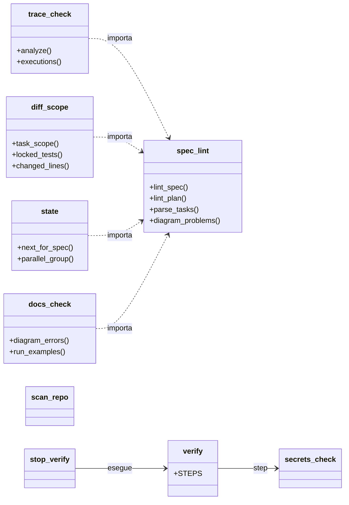
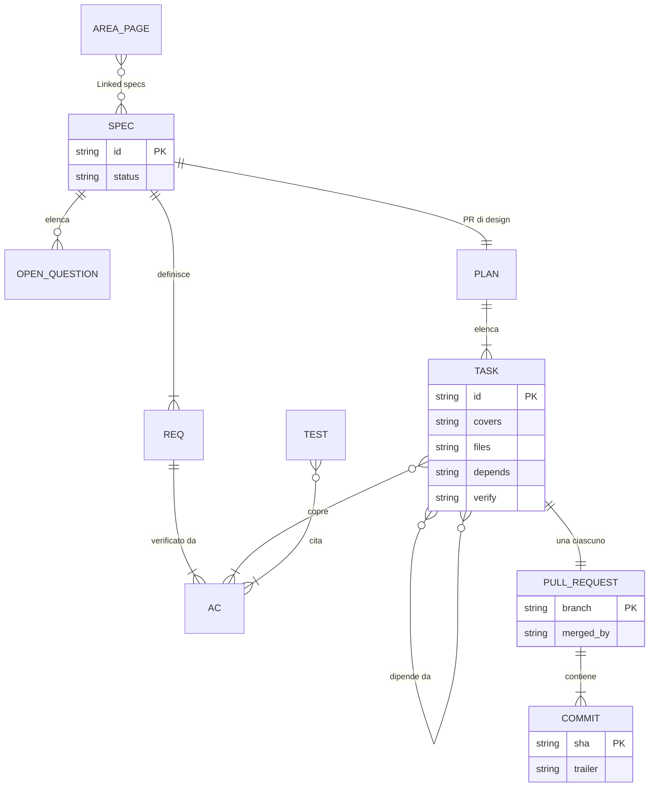

# Architettura del plugin

*English version: [architecture.md](architecture.md)*

Documento di progetto **come costruito** (versione 0.30.0): scelte, struttura, contratti tra i file e limiti.

## Obiettivo e criterio di successo

Guidare lo sviluppatore attraverso il [playbook](playbook-ai-software-lifecycle_IT.md) con la minima cerimonia che
mantiene affidabile il risultato. Il plugin è fatto bene se:
1. una feature va dall'idea a `main` con tre tipi di decisione umana (spec, piano, un merge per PR), tutte a opzioni;
2. ogni passo produce un artefatto verificabile (file, test, esito di uno script, PR), non solo testo in chat;
3. lo stesso contenuto funziona in Claude Code, Codex e GitHub Copilot, su Windows nativo e Linux;
4. ogni meccanismo copre un rischio che nessun altro copre (**un rischio, un meccanismo**).

## Scelte di architettura

| Tema | Scelta | Motivo |
|---|---|---|
| Unità di contenuto | **Skill** (`SKILL.md` con `name` e `description`), 7 skill | Il formato Agent Skills è comune a Claude Code, Codex e GitHub Copilot; meno skill, meno passaggi di consegna |
| Distribuzione | Un repository, **tre manifest** (`.claude-plugin/plugin.json`, `.codex-plugin/plugin.json`, `plugin.json` alla radice per la Copilot CLI) sulle stesse skill | Un solo contenuto, tre punti d'ingresso |
| Controlli | **Script Python deterministici**, sola libreria standard, copiati da `sdd-start` nella cartella `scripts/` del progetto | Un controllo che gira vale più di una regola in prosa; il progetto resta verificabile senza il plugin |
| Approvazione | **Il merge di una PR**, deciso dall'utente con un'opzione: la PR di design approva spec e piano, ogni PR di task approva il suo codice | Git registra chi ha unito cosa; hash, campi firmati e script di approvazione coprivano lo stesso rischio e hanno prodotto passaggi manuali ed errori nella prima prova reale |
| Proporzionalità | **Un solo flusso per tutto**; task verticali piccoli fanno PR piccole; aree sensibili segnalate nella PR, non un livello di processo | Livelli S/M/L e profili solo/team moltiplicavano le varianti senza coprire un rischio nuovo |
| Test | Scritti dagli AC, **bloccati** (commit `Test-Lock`) prima del codice, controllati da `diff_scope.py` e dall'agente revisore; nessuna approvazione umana dei singoli test | Il rischio di test che confermano gli errori dell'agente resta coperto da un controllo automatico e da un agente indipendente |
| Review indipendente | `sdd-reviewer`, in sola lettura, **una review per PR** | Una review dove il diff è piccolo, invece di review per task più una review finale di un diff grande |
| Parallelismo | Task indipendenti (nessuna dipendenza, file disgiunti nel piano) in worktree separati, una PR ciascuno, uniti uno alla volta | Fa risparmiare tempo dove è sicuro; decide il piano, non l'agente, cosa è indipendente |
| Interazione | Ogni scelta e decisione come **opzioni da selezionare** (`interaction.md` di `sdd-start`) | Approvazioni a testo libero e dialoghi a una domanda per messaggio erano la fonte principale di attrito |
| Diagrammi | Mermaid: il flowchart nel piano; i **cinque diagrammi** (flowchart, sequenza, stato, classi, ER) nella pagina d'area scritta dall'ultimo task, ricavati dal codice | Al piano serve il flusso; alla documentazione serve il quadro completo di ciò che è stato costruito |
| CI nei progetti | Facoltativa, solo `verify` su ogni PR | L'unica prova indipendente che i test passano su una macchina pulita; i controlli di processo in CI duplicavano quelli locali |
| Parti specifiche per agente | Claude Code: subagent `sdd-reviewer`, hook opt-in, subagent in worktree per `sdd-parallel`. Copilot: lo stesso revisore come custom agent, skill in `.github/skills/`. Codex: nuove sessioni | Le skill restano le stesse; cambia solo l'orchestrazione |
| Linguaggi di programmazione | Indipendente dallo stack: `verify.py` esegue i comandi del progetto; file di test e manifest riconosciuti per gli ecosistemi comuni ed estendibili in `AGENTS.md`; unico requisito Python 3.8+ per gli script | Progetti in Rust, C/C++, shell, PowerShell, Docker Compose o Helm non devono richiedere modifiche al plugin |
| Lingua | Documentazione, changelog e review in inglese e in italiano (`_IT`); il plugin interamente in inglese | Contratti sui file (nomi dei campi letti dagli script) in una sola lingua |

## Struttura del repository

```
sdd-playbook/
├── README.md, README_IT.md, CHANGELOG.md, CHANGELOG_IT.md, REVIEW.md, REVIEW_IT.md, LICENSE (MIT)
├── plugin.json            manifest della Copilot CLI (formato Agent Plugins)
├── .claude-plugin/        plugin.json, marketplace.json
├── .codex-plugin/         plugin.json
├── skills/
│   ├── sdd-start/        SKILL.md, scripts/ (8 script), references/ (template della spec, AGENTS.md, interaction,
│   │                     constitution, CI, tasks.json, stack, gitattributes, copilot/)
│   ├── sdd-plan/         SKILL.md, references/plan-template.md, diagrams.md
│   ├── sdd-task/         SKILL.md, references/test-conventions.md, area-template.md, pr-body.md
│   ├── sdd-parallel/     SKILL.md
│   ├── sdd-map/          SKILL.md, references/map-template.md
│   ├── sdd-bugfix/       SKILL.md, references/bugfix-template.md, debugging.md
│   └── sdd-next/         SKILL.md
├── agents/sdd-reviewer.md       subagent (Claude Code); copia per Copilot in skills/sdd-start/references/copilot/
├── hooks/                        hooks.json, run.sh (launcher), stop_verify.py, pretool_guard.py (Claude Code, opt-in)
├── docs/                         in inglese e in italiano (_IT): guida rapida, playbook, skill, script, architettura
├── tests/                        test di script, hook, un flusso completo di feature, e coerenza
└── .github/workflows/ci.yml      test su Ubuntu e Windows
```

Una skill legge i propri file con percorsi relativi alla sua cartella e trova i file di un'altra skill con una ricerca
(`**/sdd-task/references/area-template.md`), mai con `../`: un host può installare le skill una per una.

Come dipendono tra loro gli script (moduli disegnati come classi, con le funzioni principali): `spec_lint` contiene il
parsing di spec e piano condiviso dagli altri; l'hook `Stop` esegue `verify` come processo separato.



## Macchina a stati (`state.py`)

Il passo successivo si legge dai file e da git, mai dalla chat: inizializzazione (`AGENTS.md`, `scripts/verify.py`) →
`sdd-map` per codice esistente senza mappa → `sdd-start` finché la spec è `draft` → `sdd-plan` finché spec e piano non
sono su `main` → `sdd-task` per il task pronto, o `sdd-parallel` quando due o più task pronti hanno file disgiunti →
`sdd-task` per chiudere la feature quando tutti i task sono uniti. Un task è fatto quando la sua casella è spuntata nel
piano **su `main`**, pronto quando tutte le sue dipendenze sono fatte. La tabella completa è in [scripts_IT.md](scripts_IT.md).

## Contratti sui file

Gli script leggono pochi campi con convenzioni fisse. I nomi dei campi sono in inglese e fanno parte del contratto.

| File | Campi e strutture letti | Script |
|---|---|---|
| `spec.md` | titolo `# SPEC-<id>: ...` (data + slug uguale alla cartella, o un numero); `- Status:` (`draft`, `approved`, `implemented`, `superseded`); sezioni `## Problem and goal`, `Scope`, `Requirements`, `Acceptance criteria`, `Open questions`; riga `**Non-scope (explicit):**`; riga `**Anti-goals:**`; sezione `## Current behaviour and impact` (avviso se manca); `- REQ-nnn`; `- AC-nnn [REQ-nnn]`; marcatore `[ASSUMPTION]`; domande aperte `- <domanda> — blocking: yes|no` | `spec_lint`, `state`, `trace_check` |
| `plan.md` | sezioni `## Approach`, `## Flowchart` (un flowchart ```` ```mermaid ````), `## Tasks`, `## Review focus` (voci o `- none`); righe di task `- [ ] T-nn <obiettivo> — covers: AC-nnn — files: `percorso` — depends: T-nn \| none — verify: `<comando>``; la casella spuntata dalla PR del task stesso | `spec_lint`, `state`, `trace_check --task`, `diff_scope --task` |
| git | `main` (o `master`): la versione approvata di spec e piano, e i task spuntati; trailer `Test-Lock: T-nn` (o `BUG-nnn`) sul commit dei test rossi, che blocca i suoi file di test; trailer `Task: T-nn` sui commit di implementazione | `state`, `diff_scope`, hook `Stop` |
| file di test | `# SPEC-<id>` nel file più `AC-nnn`, oppure citazioni `SPEC-<id>/AC-nnn`; righe `TODO`/`FIXME`/`XXX` ignorate | `trace_check` |
| report JUnit XML (`reports/junit.xml`) | `testcase` con `name`, `classname`, `file` e figli `failure`, `error`, `skipped` | `trace_check --junit` |
| `docs/system/<area>.md`, `map.md` | sezione `## Diagrams` con `### Flowchart`, `### Sequence diagram`, `### State diagram`, `### Class diagram`, `### ER diagram`, ognuna un blocco Mermaid del suo tipo o `- n/a: <motivo>` (mai il flowchart) | `docs_check` |
| `docs/bugs/BUG-*.md` | `- Status:` (`open`, `diagnosed`, `fixed`, `verified`) | `state` (bug aperti) |
| `AGENTS.md` | righe `- Do not modify: a, b` (errori), `- Sensitive areas: a, b` (segnalate), `- Test files: a, b` e `- Dependency manifests: a, b` (aggiunte a quelli riconosciuti), percorsi tra backtick o prima parola, lette dal merge-base; sezioni `## Decision rights` e `## Areas` (indice delle pagine d'area; lette dagli agenti); aggiornato solo alla PR di design e alla chiusura di una feature | `diff_scope`; `sdd-task`, `sdd-reviewer` |
| `scripts/verify.py` | lista `STEPS` | (adattata da `sdd-start`) |
| `scripts/*.py` | seconda riga `# sdd-playbook: <versione>` | `sdd-start` (aggiornamento), test di coerenza |
| manifest e lockfile | solo il nome del file | `diff_scope` (avviso) |
| `.secrets-ignore` | un glob per riga, `#` per i commenti | `secrets_check` |

Un campo con segnaposto `<...>` o vuoto vale come **non compilato**.

Il modello di tracciabilità che questi contratti costruiscono, dalla spec al merge:



## Differenze tra Claude Code, Codex e GitHub Copilot

| Aspetto | Claude Code | Codex | GitHub Copilot |
|---|---|---|---|
| Skill | sì, con il prefisso del plugin | sì (formato Agent Skills) | Copilot CLI: plugin dal `plugin.json` alla radice; cloud agent e IDE: `.github/skills/` copiate da `sdd-start` |
| Revisore `sdd-reviewer` | subagent | una nuova sessione con le stesse istruzioni | custom agent `.github/agents/sdd-reviewer.agent.md` (strumenti `read`, `search`) |
| Task in parallelo | subagent con isolamento in worktree | sessioni separate, una per worktree | il coding agent su una issue per task, o sessioni CLI separate |
| Hook `Stop` e `PreToolUse` | sì, opt-in | non previsti | non portati |
| Contesto del progetto | `CLAUDE.md` con `@AGENTS.md` | legge `AGENTS.md` | legge `AGENTS.md` |

## Sicurezza e supply chain

- Le skill istruiscono l'agente e gli script girano con i permessi dell'utente: distribuisci il plugin da un repository
  rivisto e fissa una versione per progetto.
- Nessuno script scarica o esegue codice dalla rete; `docs_check.py --run-examples` esegue solo i blocchi Python marcati.
- Gli hook sono inattivi per default e non sono un sandbox; la guardia blocca su un evento illeggibile (fail-closed).
- `secrets_check.py` gira come step di `verify`; un manifest delle dipendenze modificato è un avviso nella PR e una
  nuova dipendenza è una decisione "Asks first".
- Prompt injection: il revisore tratta il contenuto del repository come dati; la difesa vera è un ambiente dell'agente
  senza segreti, con rete limitata.
- La CI facoltativa fissa le action per tag maggiore (`checkout@v6`, `setup-python@v6`): in contesti regolati fissale
  per SHA.

## Limiti e punti non verificati

- **Stato:** in progettazione; provato una volta su un piccolo progetto con la 0.17.0, i cui rilievi hanno prodotto la
  0.30.0. La 0.30.0 non è ancora stata eseguita da un agente reale su un progetto, né i worktree in parallelo.
- **Il merge come approvazione:** niente di tecnico impedisce a un agente di unire da solo; la prova della decisione è
  la selezione dell'utente e il merge che la segue. Chi ha bisogno di una garanzia protegge `main` sulla piattaforma.
- **Test senza approvazione umana:** il blocco ferma le modifiche successive, il revisore giudica come i test derivano
  dagli AC; un AC vago non lo salva nessuno dei due. Un secondo commit `Test-Lock` è ammesso e va spiegato.
- **Euristiche:** `diff_scope.py` dipende dai `files:` del piano e riconosce i manifest dal nome; `trace_check.py`
  trova gli ID per testo e non capisce la semantica dei test; senza `--junit` non controlla che i test girino e
  passino; `scan_repo.py` è un inventario.
- **Guardia e segreti:** la guardia analizza i comandi per parole e segmenti e un comando costruito apposta la aggira;
  `secrets_check.py` riconosce solo formati noti e non legge la storia di git.
- **Codex e GitHub Copilot:** manifest e percorsi costruiti dalla documentazione pubblica, non provati.
- **Hook di Claude Code:** exit code 2 come blocco e formato JSON sono quelli attesi, non osservati in una sessione; su
  Windows richiedono una shell che trovi `sh` (Git for Windows).
- **Perimetro:** rilascio, infrastruttura e operazioni sono fuori dal plugin.

## Test e coerenza

`python -m unittest discover -s tests -v`. Oltre ai test degli script (su repository git temporanei), di un flusso
completo di feature attraverso `state.py` (spec, PR di design, due task dipendenti, task in parallelo) e degli hook, i
**test di coerenza** controllano che:
- le 7 skill abbiano frontmatter valido, `name` uguale alla cartella, meno di 150 righe e riferimenti portabili (niente
  `../`, ogni percorso citato esiste);
- i template corrispondano agli script (il template del piano segnala solo ciò che resta da compilare; i template di
  pagina d'area e mappa hanno le cinque sottosezioni dei diagrammi; nessun campo di livello o di approvazione resta),
  `AGENTS.md` abbia i diritti decisionali, la guida alle interazioni abbia le tre decisioni e i due percorsi di merge,
  ogni skill con uno STOP la citi;
- ogni script e opzione citati esistano, ogni script e skill siano documentati nelle due lingue, ogni `§` citato esista
  nei due playbook con la stessa numerazione, e il playbook resti breve;
- ogni documento esista in inglese e in italiano e rimandi all'altra lingua; i file del plugin non contengano italiano;
- manifest, changelog, README e script portino la stessa versione; il revisore non abbia strumenti di scrittura; le
  action della CI siano aggiornate;
- i link relativi e i blocchi Mermaid della documentazione siano validi (`docs_check.py`).
