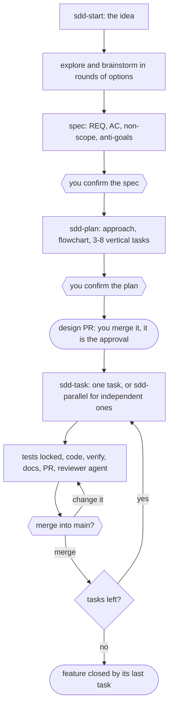

# SDD Playbook: software lifecycle with coding agents

*Versione italiana: [playbook-ai-software-lifecycle_IT.md](playbook-ai-software-lifecycle_IT.md)*

A short method for building software with coding agents: the human decides **what** to build and **whether to merge
it**; the agent writes spec, plan, tests and code; scripts check that every step was really done. The details live in
the templates and skills of the `sdd-playbook` plugin, which this document cites instead of copying.

## 0. Principles

1. **The spec is the source of truth, the code is a derivative.** The agent does not guess requirements: it asks.
2. **Every task has an executable check** (tests, lint, types, build). Without one, the only signal is "looks done"
   and you are the verifier.
3. **Vertical, verifiable tasks.** Each task delivers a behaviour with its acceptance criteria, in one PR, and a
   command says whether it passed.
4. **Context is a scarce resource.** Short `AGENTS.md`, focused specs, state in files and in git, not in the chat.
5. **Human decisions at the right points:** you confirm the spec and the plan (which lists the tasks), and you decide
   the merge of every PR. You do not approve the single tests: they are written from the acceptance criteria, locked
   before the code and checked by an independent reviewer agent.
6. **If the result is wrong, fix the spec or the tests, not the prompt.**
7. **Specs and documentation are maintained in the same PR** that changes the behaviour; the area page is the living
   documentation, with its diagrams drawn from the code.
8. **Wherever possible, the check is a script, not a prose rule**, and every script covers a risk nothing else covers.

## 1. Setup (once per project)

`sdd-start` initializes the project the first time it runs: it copies the scripts into `scripts/`, writes
`AGENTS.md` (commands, conventions, `Do not modify` zones, `Sensitive areas`, decision rights), adapts `verify.py` to
the real commands and, with a GitHub remote, offers a CI that runs `verify` on every PR. One command is the definition
of "done": `python scripts/verify.py` (format, lint, types, tests with a JUnit report, secrets), identical on Windows,
Linux and in CI.

Permissions: the agent works on branches, never commits on `main`, never pushes or merges without your selection.
Autonomous agents run in isolated environments without secrets. The optional Claude Code hooks are a safety net, not a
sandbox: `SDD_ENFORCE_VERIFY=1` stops the agent from declaring work done with `verify` red (except in the red phase of
a task, right after its `Test-Lock` commit), `SDD_GUARD=1` blocks destructive commands and reads of `.env`.

## 2. Documents

| Document | Purpose | Written by |
|---|---|---|
| `AGENTS.md` | Commands, conventions, zones not to touch, sensitive areas, decision rights, the `## Areas` index of the area pages; under 100 lines, only durable project-wide facts | `sdd-start`; updates proposed at the design PR and at the feature's close |
| `docs/specs/<id>/spec.md` | Problem, scope, **non-scope**, **anti-goals**, **current behaviour and impact** (what exists and must not change), use cases, requirements (REQ), acceptance criteria (AC, Given/when/then), open questions | `sdd-start` |
| `docs/specs/<id>/plan.md` | Approach and discarded alternative, interfaces, **flowchart**, 3 to 8 **vertical tasks**, review focus, risks | `sdd-plan` |
| `docs/system/<area>.md` | Current behaviour of an area with the **five diagrams** (flowchart, sequence, state, class, ER) drawn from the code | the last task of a feature |
| `docs/system/map.md` | Map of an existing codebase, with its diagrams, tried commands and baseline | `sdd-map` |
| `docs/bugs/BUG-nnn.md` | Reproduction, unchanged behaviour, root cause of a non-trivial bug | `sdd-bugfix` |
| PR description | Covered ACs, check results, reviewer's verdict, decisions taken alone, sensitive files | `sdd-task` |

A task line: `- [ ] T-nn <goal> — covers: AC-nnn — files: `path` — depends: T-nn | none — verify: `<command>``.

## 3. Flow of a feature

**`AGENTS.md` grows with the project, not with the features.** At the design PR the agent proposes the durable facts
the design brings (new commands, sensitive areas, zones not to touch, conventions, the ADR of a new dependency); at the
feature's close, one line in `## Areas` for the area page and the lessons that apply to the whole project. Both as
options (`Apply`, `Skip`), both in the PR; feature details stay in spec, plan and area page.

Your decisions for a feature of five tasks: the spec, the plan and five merges, each one an option to select.
`sdd-next` (or `python scripts/state.py`) tells the next step at any time, reading spec, plan and merged tasks from git.

## 4. Tasks and PRs

**Vertical tasks.** A task delivers a behaviour someone can observe end to end, not a layer ("models", then "API",
then "UI"). It covers its ACs and fits a PR readable in 15-30 minutes. More than 8 tasks means two features.

**One task, one branch, one PR** (`sdd-task`):
1. **tests first**, from the task's ACs, red for the right reason, committed alone with the trailer `Test-Lock: T-nn`:
   from then on they do not change (`diff_scope.py`), and the implementation must make them pass as they are;
2. **the code**, committed with `Task: T-nn`, within the task's files and the plan's interfaces;
3. **the checks**: `verify` green, `trace_check.py --task` (every covered AC has a test, executed and passed in the
   JUnit report), `diff_scope.py --task` (forbidden zones and locked tests are errors; files outside the task,
   dependencies, size and sensitive areas are warnings);
4. **the documentation** the task changes, in the same PR; the last task also writes the area page with the five
   diagrams and sets the spec to `implemented`;
5. **the independent review** of `sdd-reviewer` (read-only, fresh context): ACs really implemented, tests derived from
   the ACs and free of anti-patterns, nothing outside the scope, decisions within the decision rights;
6. **the merge question** with the results in front of you. The merge is the approval; git history records it.

A task whose predecessor is not merged does not start. **Tests written after the code** (integration, end to end)
take the spec as the oracle: expected values come from the ACs, never from the code's output.

## 5. Parallel agents

Independent tasks (no dependency between them, disjoint files in the plan) can run in parallel (`sdd-parallel`): one
git worktree, one branch, one agent and one PR per task, at most three at a time. The merges happen one at a time;
after each one the other branches are rebased on `main` and checked again before their merge question. A conflict
means the plan's files or interfaces were wrong: the plan is corrected, not the code forced.

## 6. Existing codebases

The main risk is that the agent changes what it should not touch. **Every change to existing code starts with an impact
analysis** (`sdd-start`): the area pages listed in `AGENTS.md` (`## Areas`) and the specs they link, the code and its
callers, the tests that protect the behaviour today (run, green), `git log` of the files involved. The spec records it
in `## Current behaviour and impact`: what exists today, what changes, what must not change and which tests protect it.
A behaviour that must not change and has no test gets characterization tests first.

For code that has never been mapped, `sdd-map` comes before any spec: a deterministic
inventory (`scan_repo.py`), the real commands tried, the **baseline** (a red one is declared, not hidden), the map with
its diagrams, `Do not modify` and `Sensitive areas` in `AGENTS.md`. Then, area by area and only where you are about
to work, **characterization tests** that pin the current behaviour and are proven able to fail. The spec describes only
the change, with an explicit non-scope.

## 7. Bugs

**Read, reproduce, pin with a red test, diagnose, fix the minimum, check that nothing else changed** (`sdd-bugfix`).
Before reproducing, the agent reads the area page and the spec (the ACs say what is expected), runs the area's tests
and looks at `git log`/`git blame` of the suspect files: a recent change is often the cause. You
confirm the expected behaviour and the behaviour that must not change; the red test is locked like a task's; the root
cause is verified, not guessed; after three failed attempts the agent stops. A trivial bug (obvious cause, one line)
needs only a red test, the fix and `verify`. One bug, one PR, one merge question.

## 8. Checks and limits

| Script | What it checks |
|---|---|
| `verify.py` | The definition of "done": format, lint, types, tests, secrets |
| `spec_lint.py` | Spec structure, REQ→AC, non-scope, blocking questions; plan with flowchart and valid vertical tasks |
| `trace_check.py` | Every AC (or the task's, with `--task`) has a test of its spec, executed and passed with `--junit` |
| `diff_scope.py` | The task branch: forbidden zones, locked tests, files outside the task, sensitive areas, dependencies, size |
| `state.py` | The next step, from spec, plan and the tasks merged on `main` |
| `docs_check.py` | Links, Mermaid diagram types, the five diagrams of every `docs/system/` page, runnable examples |
| `secrets_check.py` | Keys, tokens and `.env` files in the branch |
| `scan_repo.py` | Inventory of an existing codebase |

Limits: a script checks that something exists and has the right form, not that it is true; the reviewer agent and you
judge the rest. The merge is decided by your selection, and nothing technical stops an agent from merging by itself:
protect `main` on the platform when you need a guarantee. Release, infrastructure and operations are outside this
method: the agent prepares and verifies, the human executes.

## 9. Anti-patterns

- Long prompts instead of a versioned spec; answering the agent's questions in the chat and not in the spec.
- Horizontal tasks (one per layer) or dozens of tiny tasks: neither can be checked as a behaviour.
- Raising the ceremony "to be safe": more documents and gates do not replace a good AC and a test that can fail.
- Tests written from the code's output, or changed to make the implementation pass.
- Merging with a red `verify`, or without reading the sensitive files the PR lists.
- Several agents on tasks that share files or undecided interfaces.
- Documentation updated later, in another PR: it never happens.
