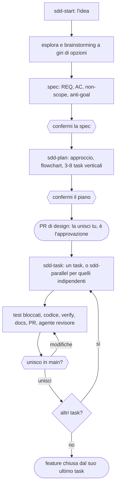

# SDD Playbook: ciclo di vita software con coding agent

*English version: [playbook-ai-software-lifecycle.md](playbook-ai-software-lifecycle.md)*

Un metodo breve per costruire software con i coding agent: l'umano decide **cosa** costruire e **se unirlo**;
l'agente scrive spec, piano, test e codice; gli script controllano che ogni passo sia stato fatto davvero. I dettagli
stanno nei template e nelle skill del plugin `sdd-playbook`, che questo documento cita invece di copiarli.

## 0. Principi

1. **La spec è la fonte di verità, il codice è un derivato.** L'agente non indovina i requisiti: li chiede.
2. **Ogni compito ha un controllo eseguibile** (test, lint, tipi, build). Senza, l'unico segnale è "sembra fatto" e
   il verificatore sei tu.
3. **Task verticali e verificabili.** Ogni task porta un comportamento con i suoi criteri di accettazione, in una PR, e
   un comando dice se è riuscito.
4. **Il contesto è una risorsa scarsa.** `AGENTS.md` breve, spec focalizzate, stato su file e in git, non nella chat.
5. **Decisioni umane ai punti giusti:** confermi la spec e il piano (che elenca i task) e decidi il merge di ogni PR.
   Non approvi i singoli test: sono scritti dai criteri di accettazione, bloccati prima del codice e controllati da un
   agente revisore indipendente.
6. **Se il risultato è sbagliato, correggi la spec o i test, non il prompt.**
7. **Spec e documentazione si mantengono nella stessa PR** che cambia il comportamento; la pagina d'area è la
   documentazione viva, con i diagrammi ricavati dal codice.
8. **Dove si può, il controllo è uno script, non una regola in prosa**, e ogni script copre un rischio che nient'altro
   copre.

## 1. Preparazione (una volta per progetto)

`sdd-start` inizializza il progetto la prima volta che parte: copia gli script in `scripts/`, scrive `AGENTS.md`
(comandi, convenzioni, zone `Do not modify`, `Sensitive areas`, diritti decisionali), adatta `verify.py` ai comandi
reali e, con un remote GitHub, propone una CI che esegue `verify` su ogni PR. Un solo comando è la definizione di
"fatto": `python scripts/verify.py` (formattazione, lint, tipi, test con report JUnit, segreti), identico su Windows,
Linux e in CI.

**Qualunque linguaggio.** Il metodo non dipende dallo stack: `verify.py` esegue i comandi del progetto (Python, Node,
.NET, Go, Java, Rust, C/C++, shell e PowerShell, Docker Compose, Helm e altri; esempi in `stacks.md` di `sdd-start`).
L'unico requisito degli strumenti è **Python 3.8+** per gli script del playbook, controllato per primo da `sdd-start`.
Test e manifest delle dipendenze di ecosistemi che gli script non riconoscono si dichiarano in `AGENTS.md`
(`- Test files:`, `- Dependency manifests:`).

Permessi: l'agente lavora sui branch, non committa mai su `main`, non fa push né merge senza la tua scelta. Gli agenti
autonomi girano in ambienti isolati senza segreti. Gli hook facoltativi di Claude Code sono una rete di sicurezza, non
un sandbox: `SDD_ENFORCE_VERIFY=1` impedisce all'agente di dichiarare finito con `verify` rosso (salvo nella fase rossa
di un task, subito dopo il suo commit `Test-Lock`), `SDD_GUARD=1` blocca comandi distruttivi e letture di `.env`.

## 2. Documenti

| Documento | Scopo | Scritto da |
|---|---|---|
| `AGENTS.md` | Comandi, convenzioni, zone da non toccare, aree sensibili, diritti decisionali, l'indice `## Areas` delle pagine d'area; sotto le 100 righe, solo fatti durevoli validi per tutto il progetto | `sdd-start`; aggiornamenti proposti alla PR di design e alla chiusura della feature |
| `docs/specs/<id>/spec.md` | Problema, scope, **non-scope**, **anti-goal**, **comportamento attuale e impatto** (cosa esiste e non deve cambiare), casi d'uso, requisiti (REQ), criteri di accettazione (AC, Dato/quando/allora), domande aperte | `sdd-start` |
| `docs/specs/<id>/plan.md` | Approccio e alternativa scartata, interfacce, **flowchart**, da 3 a 8 **task verticali**, review focus, rischi | `sdd-plan` |
| `docs/system/<area>.md` | Comportamento attuale di un'area con i **cinque diagrammi** (flowchart, sequenza, stato, classi, ER) ricavati dal codice | l'ultimo task di una feature |
| `docs/system/map.md` | Mappa di una codebase esistente, con i diagrammi, i comandi provati e la baseline | `sdd-map` |
| `docs/bugs/BUG-nnn.md` | Riproduzione, comportamento invariato, causa radice di un bug non banale | `sdd-bugfix` |
| Descrizione della PR | AC coperti, esiti dei controlli, verdetto del revisore, decisioni prese da solo, file sensibili | `sdd-task` |

Una riga di task: `- [ ] T-nn <obiettivo> — covers: AC-nnn — files: `percorso` — depends: T-nn | none — verify: `<comando>``.

## 3. Flusso di una feature

**`AGENTS.md` cresce con il progetto, non con le feature.** Alla PR di design l'agente propone i fatti durevoli che il
design porta (nuovi comandi, aree sensibili, zone da non toccare, convenzioni, l'ADR di una dipendenza nuova); alla
chiusura della feature, una riga in `## Areas` per la pagina d'area e le lezioni valide per tutto il progetto. Entrambi
come opzioni (`Apply`, `Skip`), entrambi nella PR; i dettagli della feature restano in spec, piano e pagina d'area.

Le tue decisioni per una feature di cinque task: la spec, il piano e cinque merge, ognuno un'opzione da selezionare.
`sdd-next` (o `python scripts/state.py`) indica in ogni momento il passo successivo, leggendo da git spec, piano e task
uniti.

## 4. Task e PR

**Task verticali.** Un task porta un comportamento osservabile da capo a fondo, non uno strato ("modelli", poi "API",
poi "UI"). Copre i suoi AC e sta in una PR rileggibile in 15-30 minuti. Più di 8 task vuol dire due feature.

**Un task, un branch, una PR** (`sdd-task`):
1. **prima i test**, dagli AC del task, rossi per il motivo giusto, committati da soli con il trailer
   `Test-Lock: T-nn`: da lì non cambiano (`diff_scope.py`), e l'implementazione deve farli passare così come sono;
2. **il codice**, committato con `Task: T-nn`, dentro i file del task e le interfacce del piano;
3. **i controlli**: `verify` verde, `trace_check.py --task` (ogni AC coperto ha un test, eseguito e passato nel report
   JUnit), `diff_scope.py --task` (zone vietate e test bloccati sono errori; file fuori dal task, dipendenze,
   dimensione e aree sensibili sono avvisi);
4. **la documentazione** che il task cambia, nella stessa PR; l'ultimo task scrive anche la pagina d'area con i cinque
   diagrammi e porta la spec a `implemented`;
5. **la review indipendente** di `sdd-reviewer` (sola lettura, contesto fresco): AC davvero implementati, test derivati
   dagli AC e senza anti-pattern, niente fuori scope, decisioni dentro i diritti decisionali;
6. **la domanda di merge** con i risultati davanti. Il merge è l'approvazione; la storia di git la registra.

Un task il cui predecessore non è unito non parte. **I test scritti dopo il codice** (integrazione, end to end)
prendono la spec come oracolo: i valori attesi vengono dagli AC, mai dall'output del codice.

## 5. Agenti in parallelo

I task indipendenti (nessuna dipendenza tra loro, file disgiunti nel piano) possono girare in parallelo
(`sdd-parallel`): un worktree git, un branch, un agente e una PR per task, al massimo tre insieme. I merge avvengono
uno alla volta; dopo ognuno gli altri branch si ribasano su `main` e si ricontrollano prima della loro domanda di
merge. Un conflitto vuol dire che file o interfacce del piano erano sbagliati: si corregge il piano, non si forza il
codice.

## 6. Codebase esistenti

Il rischio principale è che l'agente cambi ciò che non deve toccare. **Ogni modifica a codice esistente parte da
un'analisi d'impatto** (`sdd-start`): le pagine d'area elencate in `AGENTS.md` (`## Areas`) e le spec che collegano, il
codice e chi lo chiama, i test che proteggono il comportamento oggi (eseguiti, verdi), `git log` dei file coinvolti. La
spec la registra in `## Current behaviour and impact`: cosa esiste oggi, cosa cambia, cosa non deve cambiare e quali
test lo proteggono. Un comportamento che non deve cambiare e non ha test riceve prima i test di caratterizzazione.

Per il codice mai mappato, `sdd-map` viene prima di ogni spec: un inventario
deterministico (`scan_repo.py`), i comandi reali provati, la **baseline** (se è rossa si dichiara, non si nasconde), la
mappa con i diagrammi, `Do not modify` e `Sensitive areas` in `AGENTS.md`. Poi, area per area e solo dove stai per
lavorare, **test di caratterizzazione** che fissano il comportamento attuale e di cui si prova che possono fallire. La
spec descrive solo la modifica, con un non-scope esplicito.

## 7. Bug

**Leggi, riproduci, fissa con un test rosso, diagnostica, correggi il minimo, controlla che nient'altro sia cambiato**
(`sdd-bugfix`). Prima di riprodurre, l'agente legge la pagina d'area e la spec (gli AC dicono cosa è atteso), esegue i
test dell'area e guarda `git log`/`git blame` dei file sospetti: spesso la causa è una modifica recente. Confermi il comportamento atteso e quello che non deve cambiare; il test rosso si blocca come quello di
un task; la causa radice è verificata, non indovinata; dopo tre tentativi falliti l'agente si ferma. Un bug banale
(causa evidente, una riga) richiede solo un test rosso, la correzione e `verify`. Un bug, una PR, una domanda di merge.

## 8. Controlli e limiti

| Script | Cosa controlla |
|---|---|
| `verify.py` | La definizione di "fatto": formattazione, lint, tipi, test, segreti |
| `spec_lint.py` | Struttura della spec, REQ→AC, non-scope, domande bloccanti; piano con flowchart e task verticali validi |
| `trace_check.py` | Ogni AC (o quelli del task, con `--task`) ha un test della sua spec, eseguito e passato con `--junit` |
| `diff_scope.py` | Il branch del task: zone vietate, test bloccati, file fuori dal task, aree sensibili, dipendenze, dimensione |
| `state.py` | Il passo successivo, da spec, piano e task uniti su `main` |
| `docs_check.py` | Link, tipi di diagramma Mermaid, i cinque diagrammi di ogni pagina di `docs/system/`, esempi eseguibili |
| `secrets_check.py` | Chiavi, token e file `.env` nel branch |
| `scan_repo.py` | Inventario di una codebase esistente |

Limiti: uno script controlla che qualcosa esista e abbia la forma giusta, non che sia vero; il resto lo giudicano
l'agente revisore e tu. Il merge lo decide la tua selezione, e niente di tecnico impedisce a un agente di unire da
solo: proteggi `main` sulla piattaforma quando ti serve una garanzia. Rilascio, infrastruttura e operazioni sono fuori
da questo metodo: l'agente prepara e verifica, l'umano esegue.

## 9. Anti-pattern

- Prompt lunghi invece di una spec versionata; rispondere alle domande dell'agente nella chat e non nella spec.
- Task orizzontali (uno per strato) o decine di task minuscoli: nessuno dei due si controlla come comportamento.
- Alzare la cerimonia "per sicurezza": più documenti e gate non sostituiscono un buon AC e un test che può fallire.
- Test scritti dall'output del codice, o cambiati per far passare l'implementazione.
- Unire con `verify` rosso, o senza leggere i file sensibili che la PR elenca.
- Più agenti su task che condividono file o interfacce non decise.
- Documentazione aggiornata dopo, in un'altra PR: non succede mai.
