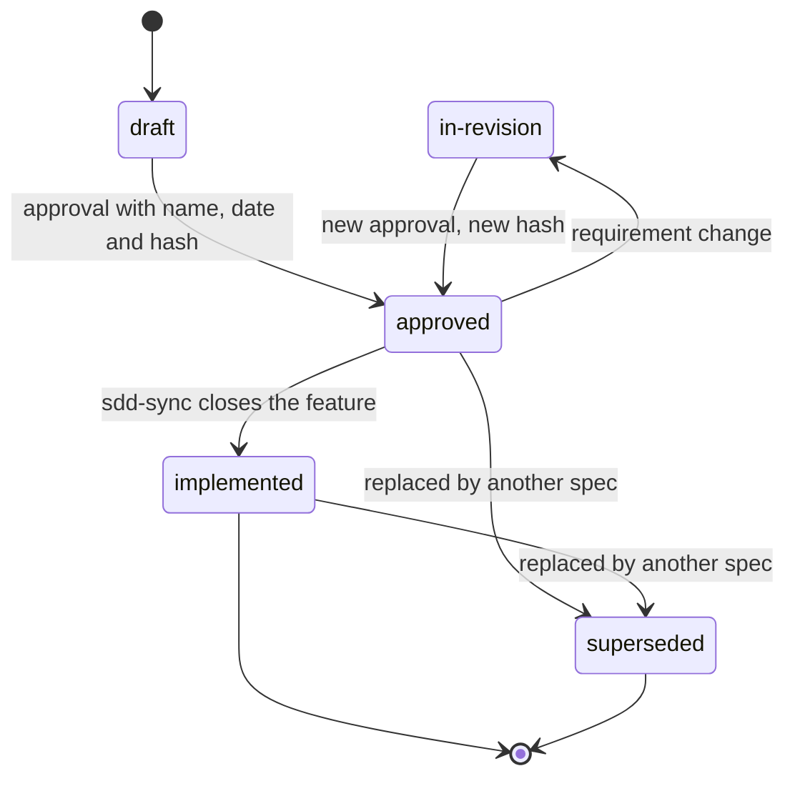
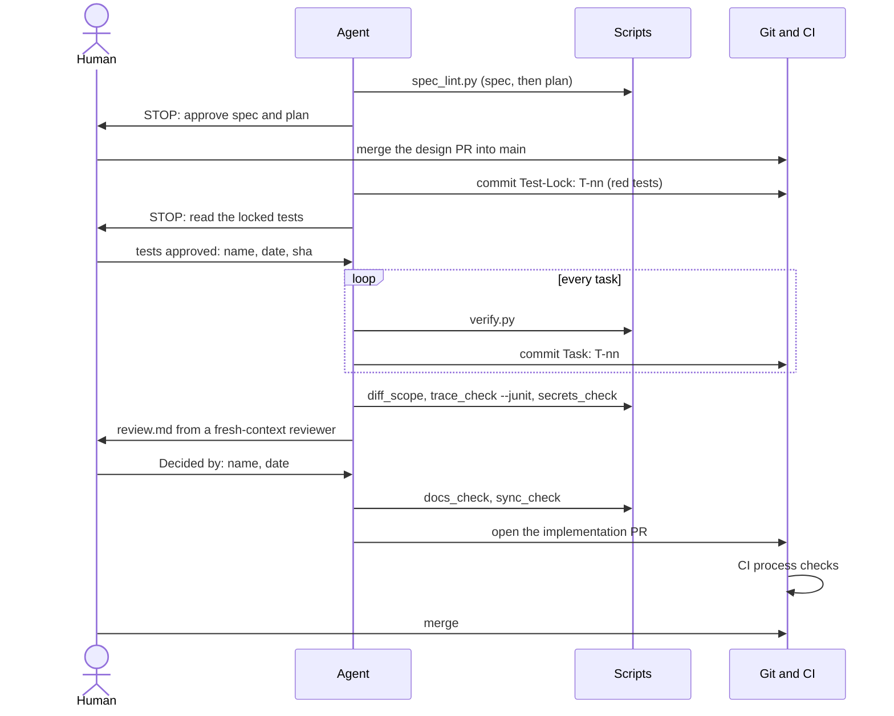

# SDD Playbook: software lifecycle with coding agents

*Versione italiana: [playbook-ai-software-lifecycle_IT.md](playbook-ai-software-lifecycle_IT.md)*

Valid for greenfield and brownfield. Reference agents: Claude Code, Codex, GitHub Copilot, or any agent that reads `AGENTS.md`.
Supported development environments: Linux, macOS, **native Windows (VS Code, PowerShell)** and WSL.

This document describes the process. The **SDD Playbook** plugin (`sdd-playbook`) automates its steps with skills and scripts (§11);
the scripts and templates shown here are **identical** to the plugin's, because the document is generated from them
(`tools/build_playbook.py`). Skills, templates and script messages are in English: field names such as `- Status:` or
`expected: red` are part of the contracts read by the scripts and must stay as they are.

> **Status of this document.** It is a synthesis of emerging practices (spec-driven development, `AGENTS.md`, verification loops), not a standard. No set of documents is "mandatory" by any norm: the documents marked *Yes* below are the minimum I recommend. Tools change version often: always check the official sources listed at the end.

Convention: **`verify`** means `python scripts/verify.py` (§1.1).

---

## 0. Principles

1. **The spec is the source of truth, the code is a derivative.** The agent must not guess the requirements.
2. **Every task has an executable check** (tests, lint, types, build). Without one, the only signal is "looks done" and you are the verifier.
3. **Small verifiable steps.** One task = one unit that a command can declare passed or failed.
4. **Context is a scarce resource.** Short `AGENTS.md`, focused specs, state in files and not in the chat.
5. **Human gates at the right points, proportional to risk:** you approve spec and plan, you approve the locked tests before implementation, you decide on the review; for level-L changes (§2.1) you also read the diff.
6. **If the result is wrong, fix the spec or the tests, not the prompt.**
7. **Specs must be maintained.** A spec not reconciled with the code stops being the source of truth: every PR that changes behaviour updates the spec or the area page.
8. **Wherever possible, the check is a script, not a prose rule.** A check that runs (IDs present, non-scope filled in, tests traced) is worth more than an instruction to the agent.

---

## 1. Environment setup (once)

| Step | What to do |
|---|---|
| Repo and git | Git repo with a protected branch; one branch per feature; small commits |
| One verification command | A script in the project's language (`scripts/verify.py`) that runs format, lint, type-check, tests. It is the agent's definition of "done". See §1.1 for template, aliases and VS Code integration |
| CI | Same verification in CI: an external check the agent cannot bypass. If you develop on Windows, a `windows-latest` + `ubuntu-24.04` matrix |
| Context file | `AGENTS.md` as the source; `CLAUDE.md` with `@AGENTS.md` on the first line (avoid symlinks: on Windows they need privileges) |
| Document checks | The scripts in `scripts/` (§11): lint of spec, plan and tasks, traceability, diff scope, project state |
| Permissions and audit | See §1.2 |
| Docs structure | `docs/` as below |
| Secrets | Outside the repo; `.env` ignored; never in the agent's context |
| Line endings | `.gitattributes` forcing LF on scripts (§1.1): CRLF files break bash scripts |

Recommended structure:

```
repo/
├── AGENTS.md                 # rules for agents (short)
├── CLAUDE.md                 # contains @AGENTS.md
├── .gitattributes            # line endings
├── .vscode/
│   └── tasks.json            # "verify" task (default test task)
├── .github/workflows/        # CI: same verification, plus process checks on PRs
├── scripts/                  # verify.py, spec_lint.py, state.py, ... (§11)
├── Makefile                  # optional: `make verify` alias for Unix
├── docs/
│   ├── constitution.md       # non-negotiable project principles
│   ├── specs/
│   │   └── 2026-10-24-feature-name/   # date + slug: it is also the spec ID
│   │       ├── spec.md       # PRD + use cases + requirements + acceptance criteria
│   │       ├── plan.md       # technical design
│   │       ├── tasks.md      # task checklist
│   │       ├── review.md     # outcome of the diff review
│   │       ├── PROMPT.md     # only if you use the loop (§7)
│   │       └── progress.md   # only if you use the loop (§7)
│   ├── system/               # map.md and one page per functional area
│   ├── bugs/                 # one file per non-trivial bug (§6.1)
│   └── adr/                  # architecture decisions
└── tests/
```

### 1.1 Verification on Windows and VS Code

**Principle:** one script, no bash-isms, same logic everywhere. Everything else (VS Code task, `make`, CI, hooks) calls it.

**Why a Python script and not a Makefile.** GNU make and `.sh` scripts are not reliable on native Windows. Python is already in many projects' stack; if your project is Node or .NET, write the same script in the project's language (`verify.mjs`, `verify.ps1`) keeping the contract identical: same exit code, same summary output. The plugin's other scripts (§11) require Python anyway.

**`scripts/verify.py`** (adapt the `STEPS` list; try every command by hand before registering it)

{{FILE skills/sdd-init/scripts/verify.py python}}

Design notes:
- The command is a **list**, without a shell: no quoting problems between PowerShell, cmd and Git Bash.
- `shutil.which` also resolves Windows shims (`npm.cmd`, `uv.exe`). If you use `uv`, steps can be `uv run ...` and the `verify` command stays `python scripts/verify.py`.
- `--fast` (format + lint + secrets) is for the interactive loop; the definition of "done" is always the full `verify`.
- The output is deliberately short (one line per step): the agent reads less noise.

**VS Code integration: `.vscode/tasks.json`**

{{FILE skills/sdd-init/references/vscode-tasks.json json}}

Usage: `Ctrl+Shift+P` → *Tasks: Run Test Task* runs `verify`. `"type": "process"` avoids the shell and therefore terminal differences; the `windows` override uses the `py` launcher when `python` is not on the PATH.

**`.gitattributes`**

{{FILE skills/sdd-init/references/gitattributes.tmpl}}

**Optional alias for Unix (`Makefile`)**

```make
verify:
	python scripts/verify.py
```

**CI (GitHub Actions)**

{{FILE skills/sdd-init/references/ci-github-actions.yml yaml}}

**Where `verify` runs, and who runs it**

| Context | Command | Note |
|---|---|---|
| You, in VS Code | `verify` task (or integrated terminal) | Works in PowerShell, cmd, Git Bash, WSL |
| Agent (Claude Code, Codex, GitHub Copilot) | `python scripts/verify.py`, stated in `AGENTS.md` | According to the Claude Code documentation consulted in October 2026, on native Windows it uses Git Bash if present, otherwise PowerShell: the script is shell-independent |
| Agent hook (optional) | The plugin's `Stop` hook with `SDD_ENFORCE_VERIFY=1` (§11) | Never the only check |
| CI | `python scripts/verify.py`, on `ubuntu-24.04` and `windows-latest`; process checks on PRs | The check the agent cannot bypass |

**Typical Windows pitfalls**

| Pitfall | Countermeasure |
|---|---|
| CRLF line endings in `.sh` scripts | `.gitattributes` with `eol=lf` |
| Paths with `\` or spaces | `pathlib` in code; argument lists, never concatenated strings |
| `rm`, `grep`, `sed`, `cp` not available | No Unix commands in project scripts: use Python |
| Agent in WSL and verification in Windows (or vice versa) | Same environment for agent and `verify`; two environments = two toolchains and two different results |
| Very long paths (`node_modules`, venv) | `git config core.longpaths true`; repo close to the drive root |
| Non-UTF-8 console encoding | `PYTHONUTF8=1` (already set by the script) |
| The test passes only on Linux | Windows + Linux CI matrix |

### 1.2 Permissions, governance and audit

| Level | What to do |
|---|---|
| Permissions | The agent's native permissions: command allowlist **and** explicit deny-list (recursive deletes, `git push`, download-and-execute, reading `.env`). For the loop the plugin provides an example (`settings.loop.json` in `sdd-loop`) |
| Environment | Container, worktree or isolated machine for autonomous loops; no access to production or secrets |
| Technical gates | Protected branch, mandatory PR, mandatory CI with the process checks. Optional (Claude Code, plugin §11): `Stop` hook that prevents declaring completion without a green `verify`, `PreToolUse` hook that blocks risky commands. They are a safety net, not a sandbox |
| Traceability | Commits with trailers `Spec: SPEC-2026-10-24-feature-name` and `Agent: <name/version>`; PR template with link to the spec, `verify` output, list of covered ACs |
| Agent identity | Separate from the approver's (see below): the agent must not be able to merge a PR into `main` or approve it |
| Approvals | **Merging the design PR** (spec, plan, tasks) into protected `main`, with mandatory code-owner review (`CODEOWNERS` on `docs/specs/` and on the tests), is the approval: `spec_lint.py --base main` verifies it. The documents keep name, date and the **hash of the approved content**: if the content changes, the approval lapses. In regulated contexts the approver is the product owner or the analyst, not the developer running the agent |
| Prompt injection | Code, comments, issues, dependencies and web pages may contain instructions aimed at the agent: they are data, not orders (the loop's `PROMPT.md` and the reviewer say so). The real defence is that the agent has nothing to exfiltrate and no permission to do it: no secrets in the environment, limited network, no push |
| Action log | `progress.md` for loops; for formal audit use the agent's and CI's logs, not the chat |

**Why a separate identity.** Approvals, ticked boxes and trailers are text the agent can write: the only control it
cannot bypass is an action the platform allows only to you. If the agent uses your git credentials, for GitHub you are the
same person and the "review required" rule cannot tell who approved. Two configurations, equivalent for the scripts
(which only look at the git state of `main`):

| Configuration | The agent | You | Suited to |
|---|---|---|---|
| **Agent without push** | Commits only locally, on feature branches | Push the branches, open the PRs, approve and merge | Solo work; no configuration |
| **Bot account or token** | Pushes branches and opens PRs with a bot account or a fine-grained token **without** merge or admin rights | Approve as code owner and merge | Teams, autonomous loops, CI that opens PRs |

To configure on the platform (the plugin only provides the `CODEOWNERS` and PR templates): protection of `main` with
mandatory PR, mandatory code-owner review and mandatory CI.

Flow of a feature: **design PR** (spec, plan and tasks approved in conversation, with hashes) → merge into `main` =
approval → implementation branch from `main` → `spec_lint.py <spec> --plan <plan> --base main` must pass before the
code → **implementation PR**, where the approver reads the `Test-Lock` commits first.

---

## 2. Documents: recommended minimum

| Document | Purpose | Minimum? | Format |
|---|---|---|---|
| `AGENTS.md` | Commands, conventions, what not to touch | **Yes** | Markdown, short |
| `constitution.md` | Stable principles (stack, security, mandatory tests) | Recommended (can be omitted if already in AGENTS.md) | Markdown |
| `spec.md` | Problem, scope, **non-scope**, use cases, requirements, acceptance criteria | **Yes** | Markdown with IDs |
| `plan.md` | Architecture, interfaces, diagrams, files involved, risks | **Yes** (levels M and L, §2.1) | Markdown |
| `tasks.md` | Small, verifiable tasks | **Yes** | Checklist |
| `review.md` | Outcome of the diff review and human decision | **Yes** (levels M and L, §2.1) | Markdown |
| Definition of Done | Single command + criteria | **Yes** | `scripts/verify.py` + section in AGENTS.md |
| ADR | Decisions with rationale | Recommended | Markdown |
| `progress.md`, `PROMPT.md` | Memory and instructions between iterations | Loop only | Markdown |
| `bugfix.md` | Diagnosis and non-regression of a bug | For non-trivial bugs | Markdown |
| `docs/system/map.md` | Codebase map, with the diagrams of the existing system | **Yes** in brownfield | Markdown |
| `docs/system/<area>.md` | Current behaviour per area, with its diagrams, reconciled after every feature | Recommended (mandatory in brownfield) | Short Markdown |

### 2.1 Levels S, M, L

Not every change deserves the same process. The spec declares the level (`- Level: S | M | L`) and it is approved with
the rest: the level is part of the hash, so lowering it after approval voids the approval. `diff_scope.py` checks that the
real diff does not exceed the declared level.

| Level | When | Documents | Review |
|---|---|---|---|
| **S** | All true: at most 3 production files (tests, `docs/` and `*.md` excluded), no public interface or data format changed, no sensitive area, no new or changed dependency | `spec.md` and `tasks.md` (no plan; `T-DOC` optional), tests from the ACs | Deterministic checks and the PR review; no `review.md`, area page optional |
| **M** | The normal case: everything that is neither S nor L | All those in §2 | `review.md` with a fresh-context reviewer and human decision; review per task optional (`- Task review: on`) |
| **L** | At least one: sensitive area (`- Sensitive areas:` in `AGENTS.md`: authentication, payments, personal data, migrations), public interface or data format changed incompatibly, data migration | As M, plus an ADR for the decisions taken | As M, plus the **review per task** (mandatory) and the **human reading of the diff** (`- Human diff review:` in `review.md`) |

Criteria checked by `diff_scope.py`: a file in a sensitive area requires L; a change to a dependency manifest or lockfile,
or more than 3 production files, require at least M. Public interfaces and data formats cannot be recognized by a script:
whoever approves the spec judges them. When in doubt, the higher level.

After `implemented` the spec becomes an archive: the living source of behaviour is the area page and the tests.

Rule for trivial bugs (obvious cause, one-line diff): red test, fix, `verify`, no `bugfix.md`.

---

## 3. Templates

### 3.1 `AGENTS.md` (keep it under ~100 lines)

{{FILE skills/sdd-init/references/AGENTS.md.tmpl markdown}}

**Decision rights.** The three lists draw the line between an implementation choice and a gap in the spec: what the agent *decides alone* (recorded as a ruling in `progress.md`), what it *asks first* (it stops), what it *never* does. The team moves lines between the first two; "Never" only grows, because the plugin's own rules apply whatever the file says, and a decision no line names is asked first. `AGENTS.md` is read from `main` when the branch changes it and is protected by CODEOWNERS: the branch cannot widen its own rights. The reviewer checks the rulings against the lists. *(`sdd-implement`, `sdd-loop`, `sdd-reviewer`)*

### 3.2 `constitution.md`

{{FILE skills/sdd-init/references/constitution.md.tmpl markdown}}

### 3.3 `spec.md`

{{FILE skills/sdd-spec/references/spec-template.md markdown}}

**How the spec is drawn out.** The agent first reads the code and the material the user pointed to, so it never asks what the project already answers; then it plays the request back in its own words and asks **one question per message**, the one whose answer would most change what gets built. When the request admits really different outcomes for the user, it presents 2-3 options and the user chooses. The **anti-goals** record what would make the feature a failure even if it technically works (`spec_lint.py` warns if they are missing). *(`sdd-spec`)*

Minimum quality of a spec: it declares the level (§2.1), names the files/interfaces involved, declares the non-scope, ends with an end-to-end check that demonstrates the feature. The `approved` state requires approver and date filled in, no **blocking** open question and the **body hash** (`- Hash:`, computed with `spec_lint.py --hash` after approval): `spec_lint.py` reports if the content changed after the approval. The plan also records `- Based on spec:` with the hash of the spec it was approved on, and lapses if the spec changes.

**Open questions** carry `blocking: yes|no` and, optionally, `about:` with the REQ or AC they concern (`spec_lint.py` checks that they exist). A question is blocking when its answer would change a requirement or an AC the plan relies on; one without the marker counts as blocking. An approved spec may keep non-blocking questions: the tasks covering the ACs they name (directly or through their REQ) wait for the answer (`spec_lint.py --tasks` warns), and the answer enters the spec with a revision.

**Language.** `spec_lint.py` warns on vague words in REQs and ACs ("fast", "appropriate", "should", "etc", ...): a vague requirement becomes a vague AC and a weak test. The optional `docs/glossary.md` (`sdd-init`) lists the domain terms with the synonyms to avoid, and the lint warns when a REQ or an AC uses one.

**Spec ID.** Creation date plus a short lower-case slug: `2026-10-24-export-csv`. It is the folder name and appears in the title (`# SPEC-2026-10-24-export-csv: Export CSV`); `spec_lint.py` checks that they match. With progressive numbers two people or two branches picked the same `SPEC-004`; with date and slug this does not happen, and folders stay in chronological order. Old `SPEC-NNN` IDs remain valid.

**Changing an approved spec.** `Status: in-revision` and an entry in `## Revisions` (date, what changes, why); after the changes, a new approval with a new hash. The hash chain does the rest: the plan records the spec hash and lapses, the tasks (`- Based on plan:`) record the plan hash and must be reviewed if the plan changes. States: `draft` → `approved` ⇄ `in-revision` → `implemented` (or `superseded`).



### 3.4 `plan.md`

{{FILE skills/sdd-plan/references/plan-template.md markdown}}

The files in the "Components and files" section go **one per line in the format `- path: what changes`** (the path is the first word, or the text in backticks); the paths in the "Where" column of the test strategy and of the review focus also count as planned: `diff_scope.py` uses them to detect out-of-plan changes. ACs are searched by exact ID only in the "Test strategy" section.

**Interfaces** records, for every component the tasks build, what it produces (exact names and signatures) and what it consumes: a task, or a loop iteration with fresh context, sees only its part and learns its neighbours' names from here. **Review focus** lists at most 5 input classes or failure modes the spec implies but no AC exercises (empty or huge input, encoding, concurrency, permissions), each with the test that pins it: the tests derived from the ACs cover only what the spec states, and a spec's silence on an input is not permission to break on it. `spec_lint.py --plan` requires the section (`- none` after checking). Before asking for approval the agent reviews the plan against the spec: coverage, consistent names, proportion (a plan longer than the code has transcribed it). *(`sdd-plan`)*

**Diagrams** draws the change in Mermaid, which GitHub and GitLab render in the Markdown itself: a flowchart (main flow, decisions, error paths), a sequence diagram (calls between actors and components), a state diagram (entities with a lifecycle), a class diagram (types and modules) and an ER diagram (persistent data), with the names of "Interfaces". A diagram that does not apply is replaced by `- n/a: <reason>`, never the flowchart: an honest `n/a` is worth more than a diagram drawn to fill the section. `spec_lint.py --plan` checks that every subsection holds a Mermaid block of its type or an `n/a` with a reason (warning before approval, error after); the guide with examples is `diagrams.md` of `sdd-plan`.

### 3.5 `tasks.md`

{{FILE skills/sdd-tasks/references/tasks-template.md markdown}}

`T-nn` tasks have `verify:` and `covers:` and no `<...>` placeholders; `T-DOC` and `T-SYNC` are mandatory and run after the review. `- Based on plan:` records the hash of the plan they derive from. `T-Rnn` tasks are added by the review when the outcome is `non-compliant` (§3.8): they have `verify:`, optional `covers:`, and run like `T-nn` tasks. At levels M and L, once the human has read the locked tests of an "expected: red" task, `— tests approved: <name, yyyy-mm-dd, sha>` is appended to its line, with the SHA of the `Test-Lock` commit that was read: until then `state.py` does not point to implementation and `loop.py` stops. The "expected: red" marker goes only on tasks that write tests: when the last closed task carries it and the next one is open, the spec is in the **red phase** (red tests are the expected result) and the `Stop` hook and `loop.py` take it into account.

### 3.6 `bugfix.md`

{{FILE skills/sdd-bugfix/references/bugfix-template.md markdown}}

### 3.7 Codebase map and area page

The **map** (`docs/system/map.md`) is written once, at the start of work on an existing codebase:

{{FILE skills/sdd-map-codebase/references/map-template.md markdown}}

The **area page** (`docs/system/<area>.md`) grows area by area and is reconciled after every feature:

{{FILE skills/sdd-sync/references/area-template.md markdown}}

Map and area pages carry the same five diagrams, but of the system **as it is**: the map draws the existing code, the area page is redrawn from the final code at every `sdd-sync` (the plan's diagrams are the design, not the documentation). This way the application's documentation keeps its diagrams aligned feature by feature. `docs_check.py` checks the diagram section of every page in `docs/system/`, `sync_check.py` that of the area page of the feature.

### 3.8 `review.md`

{{FILE skills/sdd-review-diff/references/review-template.md markdown}}

The outcome is one of `compliant` (compliant), `compliant with reservations` (compliant with reservations), `non-compliant` (not compliant). The final decision belongs to the human. At level L the decision-maker also reads the diff and records it in `- Human diff review:`; at level S `review.md` is not needed. With `non-compliant` every `high` (high) or `medium` (medium) problem becomes a `T-Rnn` task in `tasks.md`; when they are all closed the review is repeated (`state.py` says so).

---

## 4. Greenfield flow

| Phase | Activity | Plugin skill | Human gate |
|---|---|---|---|
| 1. Foundations | Setup (§1), `AGENTS.md`, `constitution.md` written with the agent in conversation and reviewed by you | `sdd-init` | You approve principles and stack |
| 2. Spec | From the idea to `spec.md`. Have the agent list open questions and assumptions, answer, then freeze | `sdd-spec` | **You approve the spec** (name and date in the document) |
| 3. Plan | `plan.md`, read-only | `sdd-plan` | **You approve the plan** |
| 4. Tasks | `tasks.md` in small steps, each with a verification command | `sdd-tasks` | Quick check |
| 5. Tests first | From the ACs, the agent writes the tests; they must fail for the right reason; `Test-Lock` commit | `sdd-tests-from-ac` (via `sdd-implement`) | **You approve the locked tests** (`tests approved:`; at level S a spot check is enough) |
| 6. Implementation | Task by task, `verify` at every step; commit at every green task (`Task: T-nn`); at level L (optional at M) a fresh reviewer checks every task on its review package (`review_package.py`) before the next one | `sdd-implement`, or `sdd-loop` (§7) | — |
| 7. Diff review | Fresh context, trying to refute, on the package of the whole branch; after per-task reviews it focuses on integration, non-scope and rulings; `review.md` | `sdd-review-diff` | **You decide on the review** |
| 8. Documentation | T-DOC: executed examples, valid links | `sdd-docs` | Review |
| 9. Reconciliation | T-SYNC: spec and `docs/system/` aligned with the real behaviour; spec state = `implemented` | `sdd-sync` | Review, then PR |
| 10. Replan | Between features, update `constitution.md`/`AGENTS.md` with what you learned | — | — |

`sdd-next` tells you at any time the current phase and the next step. At level S (§2.1) phase 3 is skipped and phase 7 is the PR review; at level L phase 7 includes the human reading of the diff.

The human gates of a level M or L feature, in order:



---

## 5. Brownfield flow

The main risk is that the agent changes or "improves" what it should not touch. Recommended order:

1. **Map.** Read-only, start from a deterministic inventory (`scan_repo.py`) and have the agent produce the codebase map: modules, entry points, dependencies, real build and test commands. Spot-check that it is true. *(`sdd-map-codebase`)*
2. **Real `AGENTS.md`.** With the commands that really work (tried, not inferred), the zones not to touch (`- Do not modify: ...` line) and the sensitive areas (`- Sensitive areas: ...`), paths in backticks. *(`sdd-map-codebase`, `sdd-init`)*
3. **Green baseline.** Run tests and build before any change, **also on Windows if it is a team development environment**. If they already fail, note it: it is not the agent's fault. *(`sdd-map-codebase`)*
4. **Characterization tests.** Where the area to change lacks coverage, write tests that pin the current behaviour (even if imperfect) and prove they can fail with a deliberate break. They are the safety net. *(`sdd-characterize`)*
5. **Spec of the delta only.** Do not document the whole system: describe only the change, with an **explicit non-scope** (what not to touch). *(`sdd-spec`)*
6. **Plan with impact.** `plan.md` lists files touched, callers, migrations, backward compatibility. *(`sdd-plan`)*
7. **Small, reversible changes.** One task per commit; full `verify` every time, not just the new tests. *(`sdd-implement`)*
8. **Diff review against the spec.** A subagent or a second session with fresh context checks that nothing out of scope changed; `diff_scope.py` reports out-of-plan files and forbidden zones. *(`sdd-review-diff`)*
9. **Documentation feedback.** For every area touched create or update `docs/system/<area>.md`: current behaviour in 2-3 paragraphs, constraints discovered, links to the specs. This way knowledge of the system grows area by area without documenting everything upfront. Update `AGENTS.md`/ADRs with what you discovered. *(`sdd-docs`, `sdd-sync`)*

Differences from greenfield: more time reading/characterizing, smaller specs, a test net before the code, a review more attentive to the "unexpected diff".

---

## 6. Tests and documentation

**Tests**
- Generate tests **from the acceptance criteria**, not from the code: otherwise the agent writes tests that confirm its own bugs. *(`sdd-tests-from-ac`)*
- **Locked tests:** red tests are committed alone with the trailer `Test-Lock: T-nn` (the code skeleton, if needed, in an earlier commit). From then on the implementation must make them pass without touching them: `diff_scope.py` reports as an error any later change to those files outside a new `Test-Lock` commit, which must be justified in the review. The branch CI stays red until the implementation task.
- **Approved tests:** the locked tests define "done" for the implementation, and they were written by the same agent that will implement. At levels M and L the human reads them (the diff of the `Test-Lock` commit) before implementation and records it on the task line (`tests approved: <name, yyyy-mm-dd, sha>`); `state.py`, `loop.py` and `sync_check.py` check it, and `diff_scope.py` reports a new `Test-Lock` commit after the approved SHA: changed tests must be approved again.
- Traceability: ACs restart from AC-001 in every spec, so every citation must be attributed to a spec. Declare the spec at the top of the test file (`# SPEC-2026-10-24-export-csv`) and cite `AC-001` in the name or a comment, or use the qualified form `SPEC-2026-10-24-export-csv/AC-001` (in function names `SPEC_2026_10_24_export_csv_AC_001`). `trace_check.py` checks that every AC appears in at least one test of its spec, reports requirements without tests and ambiguous citations, and ignores those in `TODO`s.
- **Executed tests, not just cited ones:** `verify` writes a JUnit XML report (`reports/junit.xml`); with `--junit` `trace_check.py` requires for every AC at least one test case executed and passed, and none failed. A citation in a skipped or never-run test is no longer enough. Mandatory at level L (`sync_check.py --junit`), always recommended.
- Levels: unit for logic, integration for boundaries, at least one e2e for the main flow.
- Check that tests can fail: break the code on purpose (or run mutation testing) and check that something turns red.
- **Tests written after the code** (integration, end-to-end, fixes) have no `Test-Lock`: the spec is the oracle. Expected values come from the ACs, never from the code's output; a test that disagrees with code outside the task stays failing and is reported, the human decides which side changes. Characterization tests are the exception: they pin the current behaviour on purpose.
- **Test quality:** a test that cites the AC and passes can still prove nothing. Before locking, and when the human approves, check the anti-patterns: assertions on mocks instead of outcomes, mocks beyond the boundaries (network, clock, randomness), methods added to production only for tests, weak assertions, `sleep` instead of waiting for a condition, expected values copied from the code's output. The table and the approval checklist are in the test conventions of `sdd-tests-from-ac`.
- If the team develops on Windows, at least the integration suite also runs on Windows in CI.

**Documentation**
- An explicit final task (`T-DOC`), not a casual addition. *(`sdd-docs`)*
- Source: spec and real code. The agent must run the examples it writes: `docs_check.py --run-examples` runs the Python blocks marked `# docs-check: run` and checks relative links; examples in other languages are tried by hand.
- What to generate: README (setup, usage), API docs, ADRs for the decisions taken, migration notes in brownfield.
- **Diagrams:** the application's documentation explains flows, interactions, lifecycles, types and data with Mermaid diagrams (flowchart, sequence, state, class, ER) taken from the area pages, which are redrawn from the code at every feature. `docs_check.py` rejects unknown diagram types and `docs/system/` pages without the diagram section; the full syntax is checked by previewing the diagram.

### 6.1 Bug fixing

A bug is not a miniature feature: the mandatory sequence is **reproduce, pin with a red test, diagnose, fix the minimum, check that nothing else changed**. *(`sdd-bugfix`, checked by `bug_lint.py`)*

| Phase | Activity | State in the file | Human gate |
|---|---|---|---|
| 1. Reproduction | The agent reproduces the bug with minimal steps. If it cannot, it stops and asks for data: no fix "by intuition" | `open` | — |
| 2. Definition | `bugfix.md`: actual vs expected (with reference to REQ/AC), and **behaviour that must NOT change** | `open` | You confirm the expected behaviour: if the spec was silent or wrong, the bug is also a spec bug |
| 3. Red test | A test that fails for the right reason (the bug's) | `open` | Spot check |
| 4. Diagnosis | Verified root cause (logs, debugger, bisect); read-only until it is clear | `diagnosed` | — |
| 5. Minimal fix | Only what is needed; no refactoring in the same commit; test on the unchanged behaviour | `fixed` | PR review |
| 6. Non-regression | Full `verify` + test on the unchanged behaviour | `fixed` | — |
| 7. Closure | Update ACs/`docs/system/` if the bug revealed a missing requirement; lesson in `AGENTS.md`/ADR | `verified` | — |

**Diagnosis techniques** (`sdd-bugfix`, `references/debugging.md`): trace the bad value back to where it is created, not where it shows up; one hypothesis and one experiment at a time, writing down the refuted ones; bisect history (`git bisect run`), input or test suite (to find the test that pollutes another); make flaky failures reproducible first. After three failed fixes the problem is probably in the design: stop and report.

Isolation: **one session, one branch and one commit per bug**. If the diagnosis spans many areas, a subagent or a fresh session does the diagnosis and delivers only `bugfix.md`; the fix starts in another session, with that file as its only context.

---

## 7. Correction loop

### 7.1 Schema

```
repeat (max N times):
  1. the agent reads spec, current task and progress.md
  2. implements or fixes one T-nn task
     ("expected: red" task: writes the tests, sees them fail, Test-Lock commit, moves on)
  3. runs `verify`
  4. green → commit, update progress.md, move to the next task
     red   → read the error, fix without touching the locked tests, retry
stop if: verify green AND no open T-nn task | N reached | no progress for K iterations
       | locked tests to approve (levels M and L)
```

The idea is the so-called "Ralph loop": an outer cycle that reruns the agent until an objective check passes. There is an official plugin for Claude Code; the `sdd-playbook` plugin provides an equivalent, agent-independent script (`loop.py`, §7.3).

### 7.2 Rules

- **Objective stop criteria:** `verify` green, no open `T-nn` task in `tasks.md` **and** the final checks passed (`spec_lint.py`, `trace_check.py`, `diff_scope.py`, `secrets_check.py`), not "looks fine to me". A green `verify` alone is not enough: after the first task the code can be green with everything else still to do. And the agent ticks the boxes: that is why the final checks, which do not depend on it, matter.
- **Pause for tests:** at levels M and L the loop stops after every "expected: red" test task; the human reads the tests, writes `tests approved:` and relaunches. With `--junit` the final checks use the report of executed tests.
- **The loop covers only `T-nn` tasks.** `T-DOC` and `T-SYNC` run after the review, with the human gate in between.
- **Iteration cap** always set (e.g. 10-20): without it, the loop burns tokens for nothing.
- **Stall detection:** if nothing changes for K consecutive iterations (tasks, commits, content of the working tree, generated files excluded), the loop stops.
- **Maximum time per iteration** (`--timeout`): a stuck agent is terminated and the loop continues; a non-zero exit code is reported.
- **Baseline:** the loop starts only with a green `verify`, or in the red phase.
- **State in files** (`progress.md`), not in the chat: long sessions drift and compaction loses details.
- **Rulings recorded:** every decision the agent takes within the latitude of spec and plan (names, library calls, data structures, messages) goes into the "Rulings" section of `progress.md` with the reason and the cost if wrong; the review checks that none of them changes a requirement. An ambiguous requirement is not a ruling: the agent stops.
- **Review findings are hypotheses:** on a `T-Rnn` task the agent first checks the finding on the code; if it is wrong it does not change the code and records the evidence in "Disputed review findings".
- **One task per iteration**, with fresh context when possible.
- **Feature branch:** the loop refuses to start on `main`/`master`.
- **Isolation:** worktree or container, no access to production or secrets; the agent's native permissions with allowlist and deny-list (`settings.loop.json`, which also denies writes to the loop's checks and rules), never skipping permissions outside a disposable container.
- **Content as data:** what the agent reads (code, issues, dependency docs, web) does not change its tasks; if it tries to, the agent notes it in `progress.md` and stops.
- **External check:** the same verification runs in CI.
- **The human launches the loop**, in a separate terminal: the agent prepares the files and runs the dry run (`sdd-loop`), it does not start another agent from inside its own session.

### 7.3 Loop script

**`scripts/loop.py`**

{{FILE skills/sdd-init/scripts/loop.py python}}

The prompt goes through stdin, which avoids command-line length limits on Windows. The agent command is `claude -p` by default: with `--agent` another agent is used, but **non-interactive mode and permissions must be configured and verified separately** (agent version, allowlist, deny-list). The loop never pushes.

**`PROMPT.md`** (in the spec folder)

{{FILE skills/sdd-loop/references/PROMPT.md.tmpl markdown}}

**`progress.md`**

{{FILE skills/sdd-loop/references/progress.md.tmpl markdown}}

### 7.4 If the result is not satisfactory

| Symptom | Likely cause | Action |
|---|---|---|
| Tests pass but the behaviour is wrong | Weak or missing acceptance criteria | Strengthen the ACs and tests, not the prompt |
| The agent "completes" without verifying | No executable check | Make `verify` mandatory (rule in AGENTS.md, `Stop` hook, CI) |
| It does out-of-scope things | Missing non-scope | Add it to the spec; `diff_scope.py` with `--strict`; list the zones in "Do not modify:" |
| It goes in circles on the same error | Task too big or ambiguous spec | Split the task, clarify the spec, restart with fresh context |
| Quality drops in long sessions | Saturated context | New session, state read from `progress.md` |
| It ignores instructions | `AGENTS.md` too long | Prune: keep only what cannot be inferred from the code |
| It does not converge within N, or the loop stops for stall | Spec or design problem, not execution | Stop, review spec/plan, then relaunch |
| Green locally on Windows, red in Linux CI (or vice versa) | Platform-dependent scripts or tests | CI matrix; remove shell commands from scripts; check line endings and case in paths |
| The agent "fixes" a bug and breaks another | Unchanged behaviour not declared | Fill in the "must NOT change" section in `bugfix.md` and add the related tests |

A second level of verification: a fresh-context subagent that tries to **refute** the result against spec and plan (`sdd-review-diff`).

---

## 8. Beyond CI: release and operations

The flow above ends with verified, reviewed and documented code. A complete lifecycle needs four more activities, sized to the system's criticality. **The plugin automates only basic security** (secrets and dependencies); the rest is outside its scope.

| Activity | Recommended minimum |
|---|---|
| Security | Secret scanning (`secrets_check.py`, a `verify` step; for the full history a dedicated tool such as gitleaks in CI), dependency audit (`pip-audit`, `npm audit`, `govulncheck`, ...) and static analysis as `verify` or CI steps; new dependencies only in the approved plan or with an ADR (`diff_scope.py`) |
| Release | Deployment pipeline with a human gate on production; `plan.md` includes rollback; release notes derived from spec and covered ACs |
| Observability | Every non-functional requirement (e.g. p95 latency) has a metric or log that makes it observable after release |
| Feedback | Incidents and reports become `bugfix.md` and, if they reveal a gap, new ACs; lessons flow into `AGENTS.md`/ADRs |

Deployment and operations performed by an agent are a separate topic: by default the agent prepares and verifies, the human approves and executes.

---

## 9. Final checklist per feature

- [ ] Spec approved (name and date), explicit non-scope, blocking open questions closed and the non-blocking ones answered before their tasks
- [ ] Every REQ has at least one AC and at least one traced, executed and passing test (`trace_check.py --junit`); locked tests approved
- [ ] `verify` green locally (also on Windows, if it is a team environment) and in CI
- [ ] Diff read against spec and plan (`diff_scope.py`, `review.md` with human decision)
- [ ] Documentation updated, examples executed, links valid, diagrams redrawn from the code (`docs_check.py`)
- [ ] Spec and `docs/system/<area>.md` reconciled; spec state = `implemented` (`sync_check.py`)
- [ ] `AGENTS.md`/ADRs updated with the lessons learned
- [ ] In brownfield: green baseline before and after, characterization tests present
- [ ] For every bug: red test before the fix, unchanged behaviour declared and tested (`bug_lint.py`)

---

## 10. Anti-patterns

- Long prompts instead of a versioned spec.
- An encyclopaedic `AGENTS.md`.
- Tests generated from the code instead of the requirements.
- Loops without a cap or an objective stop; loops that exit at the first green check with tasks still open.
- A spec for the whole system in brownfield (the delta is enough, plus the area page).
- Applying the full process to trivial changes, or level S to changes that touch sensitive areas.
- Trusting the agent's "done" without evidence (test output, diff).
- `verify` written only in bash/make, for a team that also develops on Windows.
- Fixing a bug without a red test that reproduces it.
- Specs approved and never again reconciled with the code.
- Agent in WSL and `verify` in native Windows (or vice versa).
- A review done by the same session that implemented, without fresh context.
- Approving spec, plan or review "on behalf of the human": approvals are given by a person, with name and date.

---

## 11. Automation with the `sdd-playbook` plugin

The plugin implements the steps of this playbook as **skills** (instructions for the agent, with an explicit human gate
at every approval point) and **scripts** (deterministic checks copied into the project's `scripts/` by `sdd-init`). It
works with Claude Code, Codex and GitHub Copilot (CLI and coding agent). Full guide: the plugin's `README.md` and `docs/` (start from `docs/quick-guide.md`).

| Phase | Skill | Scripts used | Human gate |
|---|---|---|---|
| State and next step | `sdd-next` | `state.py` | — |
| Setup (§1) | `sdd-init` | `verify.py` and all the others (copied into the project) | Principles and stack |
| Map and baseline (§5, steps 1-3) | `sdd-map-codebase` | `scan_repo.py`, `verify.py` | Map spot-checked |
| Characterization (§5, step 4) | `sdd-characterize` | `verify.py` | Spot check |
| Spec (§3.3) | `sdd-spec` | `spec_lint.py` | **Spec approval** |
| Plan (§3.4) | `sdd-plan` | `spec_lint.py --plan` | **Plan approval** |
| Tasks (§3.5) | `sdd-tasks` | `spec_lint.py --tasks` | Quick check |
| Tests from ACs (§6) | `sdd-tests-from-ac` | `trace_check.py` | **Approval of the locked tests** (M, L) |
| Implementation (§4, phase 6) | `sdd-implement` | `verify.py`, `review_package.py` | PR review |
| Loop (§7) | `sdd-loop` | `loop.py` | **Permissions, cap, launch** |
| Bug fixing (§6.1) | `sdd-bugfix` | `bug_lint.py`, `verify.py` | Expected and "must NOT change" |
| Diff review (§4, phase 7) | `sdd-review-diff` | `diff_scope.py`, `trace_check.py`, `secrets_check.py`, `review_package.py` | **Review decision** |
| Documentation (§6) | `sdd-docs` | `docs_check.py` | Review |
| Reconciliation (§4, phase 9) | `sdd-sync` | `sync_check.py` | Review, then PR |

**Plugin scripts** (all Python, standard library only, identical on Windows and Linux; exit code `0` = ok, `1` = check failed, `2` = wrong usage or missing precondition):

| Script | What it checks |
|---|---|
| `verify.py` | Format, lint, types, tests and secrets of the project: the definition of "done" |
| `spec_lint.py` | Spec (sections, ID, level, REQ→AC, non-scope, approval, blocking open questions; warnings for vague words and glossary synonyms); with `--plan` every AC is in the test strategy, review focus and the five diagrams filled in; with `--tasks` every task has verification and coverage and no placeholders, every AC is covered, `T-DOC` and `T-SYNC` are present |
| `state.py` | Project state and next phase for every active spec, according to its level; with several specs it uses the current branch's or `--spec` |
| `scan_repo.py` | Deterministic inventory of a codebase (stack, languages, tests, CI, entry points) |
| `trace_check.py` | Every AC cited in at least one test of its spec (`SPEC-nnn/AC-nnn` or declared file); with `--junit` also executed and passed in the report; requirements without tests; ambiguous citations |
| `bug_lint.py` | Completeness of a bug file according to its state |
| `diff_scope.py` | Changed files: forbidden zones (`Do not modify:` in `AGENTS.md`), locked tests (`Test-Lock`) changed after locking, test approvals voided by a new `Test-Lock`, level underestimated by the diff, dependencies without plan or ADR, out-of-plan files, planned files not touched |
| `docs_check.py` | Valid relative links; known Mermaid diagram types; the five diagrams in every page of `docs/system/`; marked Python examples executed successfully |
| `sync_check.py` | Closure: spec `implemented`, tasks closed, tests approved, review with human decision, area page with its diagrams, traceability (with the JUnit report at level L) |
| `secrets_check.py` | Keys and tokens with a known format and `.env` files in the branch files (or in the whole repository with `--all`) |
| `loop.py` | Outer loop with cap, stall detection, timeout per iteration, baseline, protected branch, pause for test approval, task reviews at level L and dry run |
| `review_package.py` | Not a check: writes in one file what an independent reviewer needs for a task (commits with `Task:`/`Test-Lock:`, covered ACs, plan interfaces, diagrams and review focus, rulings, patches) or for the whole branch |

**Optional hooks (Claude Code only; not ported to Codex and GitHub Copilot)**, inactive unless enabled with an environment variable. They start from `hooks/run.sh`, which exits immediately if the hook is not enabled and otherwise uses the first of `python3`, `python` and `py -3` that is Python 3; without Python the error is visible but non-blocking:

| Hook | Enabled with | Effect |
|---|---|---|
| `Stop` | `SDD_ENFORCE_VERIFY=1` (and `SDD_VERIFY_ARGS`, e.g. `--fast`; `SDD_STOP_MAX`, default 3) | If `verify` is red, the agent cannot declare the work finished, except in the red phase; it blocks up to `SDD_STOP_MAX` times per session, then lets the agent stop with a warning to the user |
| `PreToolUse` | `SDD_GUARD=1` | Blocks forced or destructive pushes, `reset --hard`, `clean -f`, recursive deletes, download-and-execute, references to `.env`; also blocks if the event is unreadable |

**Reviewer agent:** `sdd-reviewer`, the independent reviewer used by `sdd-review-diff`, read-only by construction (read tools only: it receives the diff and the check outputs in the message). Claude Code loads it as a subagent; for GitHub Copilot `sdd-init` copies an equivalent custom agent to `.github/agents/sdd-reviewer.agent.md` (tools `read` and `search`). With Codex the review happens in a new session with the same instructions.

**What the plugin does not do:** it does not approve on behalf of the human, does not launch the loop from inside a session, does not cover release, infrastructure security and operations (§8), does not configure the agent's permissions (for the loop it provides an example).

**Updates:** every script copied into the project carries the plugin version on line 2 (`# sdd-playbook: <version>`); `sdd-init` can compare it and update the scripts, without touching the `STEPS` of `verify.py`.

---

## 12. Sources

- Article on SDD tools (Kiro, Spec Kit, Tessl) on martinfowler.com: https://martinfowler.com/articles/exploring-gen-ai/sdd-3-tools.html
- GitHub Spec Kit: https://github.com/github/spec-kit
- Comparison of SDD tools: https://github.com/cameronsjo/spec-compare
- `AGENTS.md` standard: https://agents.md
- Claude Code best practices: https://code.claude.com/docs/en/best-practices
- Claude Code installation and shell on Windows (native, Git Bash/PowerShell, WSL): https://code.claude.com/docs/en/install
- VS Code tasks: https://code.visualstudio.com/docs/editor/tasks
- Codex skills (Agent Skills format): https://developers.openai.com/codex/skills
- GitHub Copilot agent skills, custom agents and CLI plugins: https://docs.github.com/en/copilot
- Agent Skills format: https://agentskills.io
- Course "Spec-Driven Development with Coding Agents" (DeepLearning.AI, with JetBrains): https://www.deeplearning.ai/courses/spec-driven-development-with-coding-agents
- Ralph loop (practical guide): https://sidbharath.com/blog/ralph-wiggum-claude-code/
- Book: Addy Osmani, *Beyond Vibe Coding* (O'Reilly)
