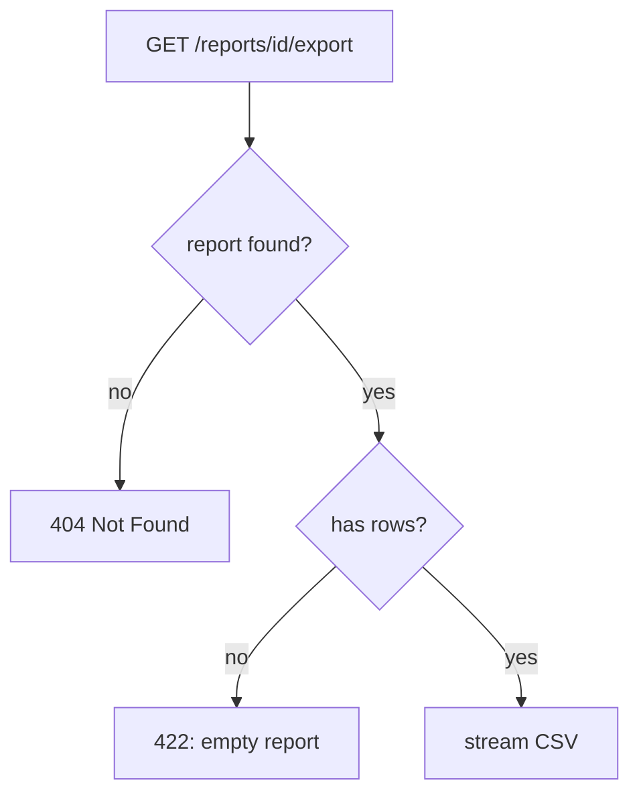
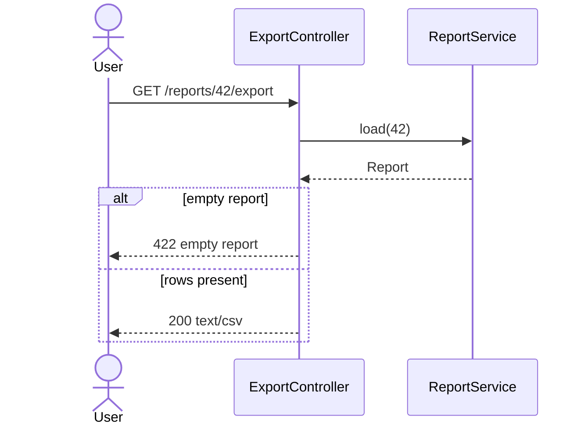
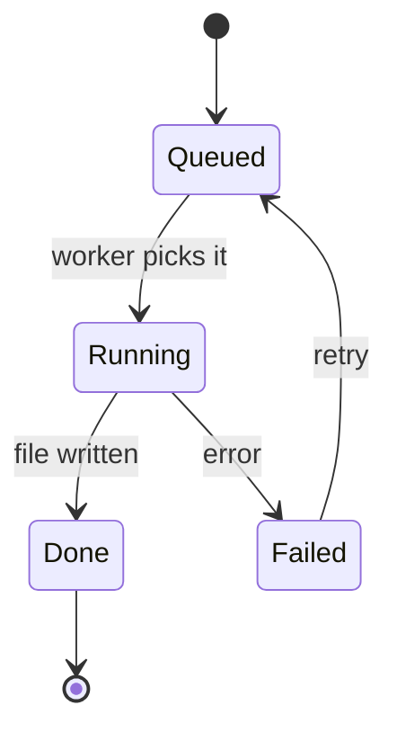
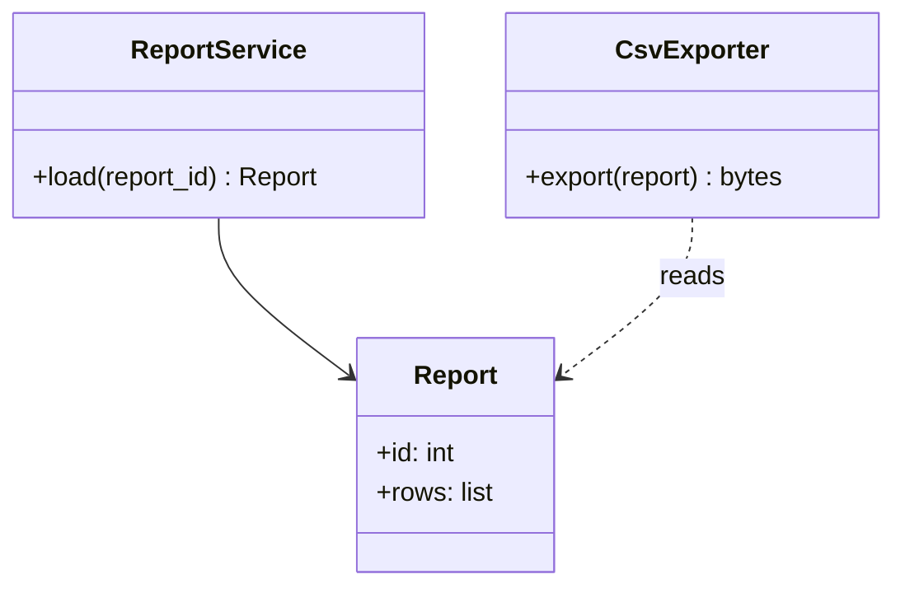
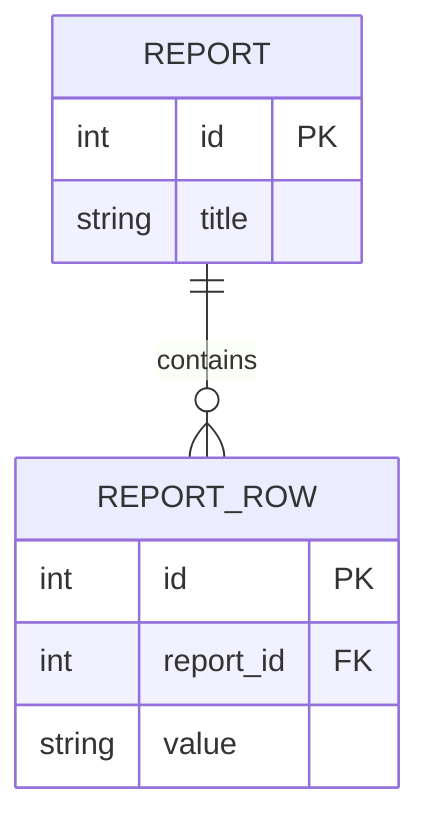

# Diagrams (Mermaid)

Plan, area pages and codebase map have a `## Diagrams` section with five subsections, checked by `spec_lint.py`
(plan), `sync_check.py` (area page) and `docs_check.py` (every page of `docs/system/`):

| Subsection | Mermaid block starts with | Draw it when | `n/a` is acceptable when |
|---|---|---|---|
| `### Flowchart` | `flowchart TD` | always: main flow, decisions, error paths | never |
| `### Sequence diagram` | `sequenceDiagram` | two or more components, services or actors exchange calls | one function with no collaborators |
| `### State diagram` | `stateDiagram-v2` | an entity, request or job has a status that changes | nothing in scope has a lifecycle |
| `### Class diagram` | `classDiagram` | the change adds or changes types, modules or their relations | no type or module changes |
| `### ER diagram` | `erDiagram` | persistent data (tables, collections, files with a schema) is added or changed | no persistent data is touched |

A diagram that does not apply is replaced by `- n/a: <reason>` with a reason a reviewer can check ("no persistent data:
the export writes to the HTTP response only"). A diagram drawn to fill the section is worse than an honest `n/a`.

## What each document draws

- **plan.md:** the change as designed, limited to what the tasks build. Names are the ones of `## Interfaces`.
- **docs/system/<area>.md:** the area as built, redrawn from the code at `sdd-sync` (not copied from the plan): it is the
  living documentation of the application.
- **docs/system/map.md:** the existing system as read in the code (brownfield): modules and their dependencies in the
  flowchart, the existing schema in the ER diagram.

Every name in a diagram (participant, class, method, table, column, status) must exist in the plan's interfaces or in
the code. A diagram that disagrees with the code is a defect, like a wrong comment: the reviewer reports it.

## Minimal examples

## Syntax traps

- Labels with parentheses, colons, quotes or slashes at the start: put them in double quotes, `A["save(x): ok"]`.
- `end` in lower case breaks flowcharts and sequence diagrams as a node or participant name: write `End` or `finish`.
- Use ` ` for a line break in a label; avoid HTML otherwise.
- One diagram per block; keep it to what fits on a screen (about 15 nodes): split by flow, not by squeezing.
- GitHub, GitLab and the VS Code Markdown preview (with a Mermaid extension) render the blocks: preview a
  diagram before committing it; `docs_check.py` checks the diagram type, not the full syntax.
